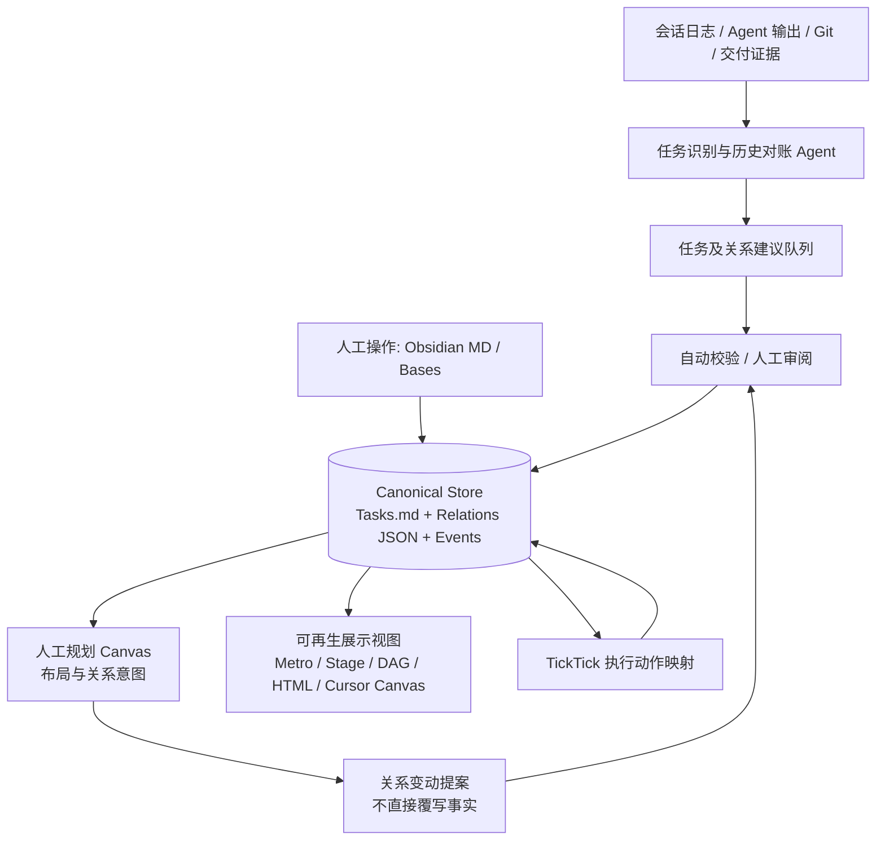

# Focus Hub：人机共用任务操作面与跨编辑器 Canvas 兼容方案

> **文档类型**：方案分析 / Agent 设计交接  
> **版本**：v1.0 · 2026-11-04  
> **范围**：汇总最近两轮关于「Obsidian / TickTick 共同操作面」与「Obsidian / Cursor Canvas 互通」的讨论。  
> **关联项目**：Focus Hub——将多条线性会话重构为可分层、可追踪、可续接的立体任务推进网络。  
> **状态说明**：本文是实施建议，并不表示插件、同步引擎或互通原型已部署完成。

## 1. 目标

### 1.1 总体目标

在已经明确的 Focus Hub 任务治理方案上，**尽量复用成熟的人工作业界面，而不重新开发常规任务编辑器**：

1. **统一人机操作面**：人工在 Obsidian 等成熟工具中创建任务、修改状态、审阅关系、保留决策；Agent 可以安全读取、提出建议、同步修改。
2. **分离事实与显示**：任务数据可被多种工具读写，轨道图 / DAG / 看板 / 关卡图由数据重新生成，而不是把具体 UI 文件当唯一真相。
3. **跨工具连续性**：Obsidian、Cursor、CLI Agent 和（按需）TickTick 通过统一任务 ID 与可移植文件协同，不要求始终在同一个客户端里工作。
4. **历史未闭环持续保留**：任务状态允许“先绕过，再继续”，自动记录遗漏、暂缓、恢复条件和 Resume Capsule，避免随会话滚动丢失。
5. **层级聚焦**：L1 全部一级目标 → L2 只显示一个选定 L1 的直接子节点 → L3 只显示一个选定 L2 的直接子节点；支持逐级提升和面包屑返回。

### 1.2 非目标

- 不把 Obsidian Canvas 设计成通用流程引擎、数据库或完整的 DAG 语义库。
- 不让 TickTick 成为全部任务、依赖、原始证据的主记录系统。
- 不追求 Obsidian Canvas 与 Cursor **内置** Canvas 的像素级、编辑体验级双向兼容。
- 不允许 Agent 每次生成展示图时抹除人工排版、覆盖人工确认的事实。

## 2. 核心假设及验证状态

| 类型 | 内容 | 当前判断 |
|---|---|---|
| 已有产品能力 | Obsidian Markdown 属性可作为 Bases 查询和操作的数据源。Bases 的原生 Kanban 视图支持按属性分组、通过拖动更新可编辑分组属性。 | **已核对**：Obsidian 官方文档注明 Kanban 需要 1.14+；拖动存在分组字段限制。 |
| 已有开放标准 | Obsidian 原生 `.canvas` 使用 JSON Canvas 格式，基本结构是 `nodes` 与 `edges`。 | **已核对**：JSON Canvas 1.0 规范。 |
| 产品事实 | Cursor 内置 Canvases 是 Agent 创建的交互式仪表盘/报告等成果，不是 Obsidian `.canvas` 的原生编辑器。 | **已核对**：Cursor 官方文档；暂无查到官方原生双向兼容承诺。 |
| 候选桥梁 | Skena 可在 VS Code 环境中可视化读写 `.canvas`，官方/项目说明称与 Obsidian 兼容。 | **已核对项目说明**；**在 Cursor 中加载与往返编辑尚未实测**。 |
| 候选桥梁 | Canvas Design 提供 VS Code 的 JSON Canvas 可视化编辑能力，支持外部 Agent 直接改 JSON。 | **已核对扩展说明**；部分非标准功能回存到其他编辑器需实测。 |
| 候选实时协作 | Bragi Canvas 可在 Obsidian 桌面端暴露本地 MCP，使 Agent 操作当前打开画布。 | **已核对产品文档**；实际权限和兼容性仍需 PoC。 |
| 工程假设 | Markdown + 标准化 JSON 关系记录 + Git 是可维护的单一事实层。 | **设计判断**；需验证增量同步、冲突处理和实际工作负担。 |
| 工程假设 | 将复杂轨道图、DAG 与决策驾驶舱作为可再生视图，能显著降低人工维护成本。 | **待用户体验验证**。 |

**重要区分：**“共享同一任务数据”“打开相同的 `.canvas` 文件”“共用 Cursor 内置 Canvas 交互体验”是三种不同层次的互通，不能混为一谈。

## 3. 候选操作面分析

| 组件 | 定位 | 优势 | 局限 | 推荐程度 |
|---|---|---|---|---|
| **Obsidian Markdown + Bases** | 主要任务编辑与列表/看板 | 本地文件、可搜索、可版本控制、Agent 可写；适合属性编辑 | 复杂关系及审计需扩展数据模型；基础看板不等同于 DAG | **主操作面，优先** |
| **Obsidian 原生 Canvas** | 人工关系规划、节点与里程碑排布 | JSON Canvas 开放格式；能链接 MD | 连线本身没有严格的“依赖/阻塞/替代”类型；手工布局会产生冲突 | **辅助关系编辑面** |
| **Advanced Canvas / 类似插件** | 原生 Canvas 的聚焦、折叠和操作增强 | 支持可折叠组、Focus Mode、Portal 等 | 扩展元数据可能影响跨工具互通 | 可选增强，先验证最小集合 |
| **Cursor 内置 Canvas** | 交互式报告和定制驾驶舱 | Agent 可创建可交互的仪表盘与报告 | 不等价于标准 `.canvas`；不作为主存储 | **展示面** |
| **Skena / Canvas Design** | VS Code 家族中的 `.canvas` 可视化编辑 | 共享开放文件；与代码和 Agent 工作区接近 | Cursor 安装适配、扩展字段往返保存待验证 | **跨编辑器候选桥梁** |
| **Bragi Canvas MCP** | Agent 实时操控 Obsidian 当前画布 | 节点/边读写、当前选中项、批量操作 | 桌面 Obsidian 必须运行；权限面扩大；产品原定位不是任务治理 | 可选增强，不作强依赖 |
| **TickTick** | 具有时间与责任人的执行动作 | 快速操作、提醒、日程与个人任务 | 复杂多类型关系、证据和遗漏恢复不宜主存 | **执行/提醒端** |

### 3.1 为什么不继续开发全部人工界面

Focus Hub 真正稀缺的能力是：

- 从大量线性对话中抽取长期目标、子任务、遗留要求与变更；
- 识别“已经继续讨论但历史事项并未完成”的断点；
- 自动建议/确认任务依赖并进行冲突治理；
- 将完整任务网络按当前关注层级投影成可控制信息密度的视图。

常规任务编辑、看板拖动、文档编辑、提醒可以由成熟工具解决。自行开发这些功能会把研发资源从差异化能力中转移出去。

## 4. Canvas 兼容性：明确结论与技术路线

### 4.1 两类 Canvas 不相通的根本原因

- **Obsidian Canvas**：以 `.canvas` 文件保存节点和边，是开放的 JSON Canvas 文件模型。
- **Cursor 内置 Canvas**：是 Agent 生成、持久展示与继续迭代的交互式成果类型，内置展示方式和数据结构不应假设等于 JSON Canvas。
- **因此**：不能靠两者都叫 Canvas 就认定可以直接互相打开、双向编辑。即使内容可转写，布局、交互与组件语义也不一定可移植。

### 4.2 三种互通策略

| 策略 | 说明 | 特点 | 建议 |
|---|---|---|---|
| **A. 文件级共享** | Obsidian 和 VS Code/Cursor 扩展读写同一 `.canvas` + `.md` | 无需 Obsidian 常驻；适合 Git 与 CLI；需要并发写保护 | **默认首选** |
| **B. MCP 实时协作** | Cursor/CLI Agent 通过 Bragi 等 MCP 读取、修改 Obsidian 活动画布 | 支持选中节点/可视界面上下文；依赖桌面进程与权限配置 | 按需增强 |
| **C. 只共享数据，不共享画布** | Markdown/JSON 是事实层，Obsidian Canvas 和 Cursor Canvas 各自生成 | 兼容性最高、最稳；人工布局不能自动对等传递 | 最稳妥回退 |

**建议先验证 A，失败则退回 C，不要让整个 Focus Hub 项目依赖某个扩展的兼容性。**

### 4.3 候选工具清单

1. **Skena**：<https://github.com/dmarienko/skena>  
   VS Code 扩展，读写 JSON Canvas 1.0，支持 Markdown 预览和 MCP。须测试 Cursor 能否安装、保存、恢复布局和边；注意其扩展专有节点类型在 Obsidian 中可能被忽略，甚至在回存时丢失。
2. **Canvas Design**：<https://marketplace.visualstudio.com/items?itemName=EvenSo.canvas-design>  
   支持 JSON Canvas 的可视化编辑、节点引用与 Agent 源文件修改。产品文档明确其为早期阶段，不提供完整自动布局与协作功能；某些显示元素依赖回退文本。
3. **Bragi Canvas**：<https://www.bragi.now/docs/feature-guide/agents-mcp>  
   使用本地 MCP 控制 Obsidian 当前 Canvas，可读节点/连线及选中状态。端口默认监听 localhost，服务默认关闭；建议启用访问令牌与最小写权限。该插件还有与任务系统无关的 AI 生成能力，使用前需要审查数据/网络边界。
4. **Advanced Canvas**：<https://community.obsidian.md/plugins/advanced-canvas>  
   侧重折叠组、聚焦、Portal 与连线操作，是人工审阅复杂关系的增强插件；应以原生 JSON Canvas 互通为优先约束。

## 5. 推荐总体架构



### 5.1 单一事实源原则

- **事实层**：任务 Markdown、关系 JSON、审计事件、来源索引。以稳定 ID 关联，不依赖文件名或 Canvas 坐标识别任务。
- **人工操作面**：Obsidian Bases/Markdown 修改事实层；Canvas 布局/连线是可分析的人工意图，但尚未确认的新关系先进入审阅队列。
- **生成展示面**：Metro / DAG / Monster Train 路径图 / Cursor Canvas / HTML 可重建；**生成过程不得回写原始事实或改变人工规划图的坐标**。
- **TickTick**：只映射到期或需要提醒的行动，保留外部任务 ID，不以 TickTick 层级取代原系统父子关系。

### 5.2 目录建议

```text
FocusHub/
├── tasks/                  # 一项关键任务一份 Markdown
│   ├── P001.md             # L1
│   ├── W011.md             # L2（parent_id=P001）
│   └── T0111.md            # L3（parent_id=W011）
├── relations/
│   └── confirmed.jsonl     # 已确认依赖/阻塞/重复/汇合等关系
├── proposals/
│   └── pending.jsonl       # Agent 推断、Canvas 人工连线的待审建议
├── sources/                # 会话片段与文件来源索引
├── events/                 # 追加式状态变更、人工决策、冲突处理记录
├── views/
│   ├── Control.base        # Obsidian Bases 看板/列表
│   ├── Planning.canvas     # 人工排布，禁止生成器整图覆盖
│   └── Project-P001.canvas # 可按 L1 拆分
├── generated/
│   ├── Metro.html
│   ├── DAG.html
│   ├── Stage.html
│   └── Review.md
└── config/
    └── sync-policy.yaml
```

### 5.3 任务 Markdown 的最小字段

```yaml
---
id: W011
parent_id: P001
level: 2
title: 任务关系识别引擎
status: paused             # active / paused / blocked / done / canceled
closure: partial           # open / partial / verified / waived
priority: high
owner: agent
review_date: 2026-11-15
revision: 7
---
```

Markdown 正文至少包含：目标与验收、已完成、遗留/遗漏、关键决策、来源与证据、Resume Capsule（当前断点、恢复条件、下一步动作）。

> **不要混淆**：`status=done` 代表当前动作执行完成；`closure=verified` 才表示原始要求已经被证据支持地闭环。二者必须单独维护。

### 5.4 任务关系的建议记录

```json
{
  "id": "REL-0008",
  "from_id": "W011",
  "to_id": "W014",
  "type": "depends_on",
  "state": "proposed",
  "confidence": 0.87,
  "evidence": ["sources/chat-2026-11-04#message-13"],
  "proposed_by": "agent",
  "reviewed_by": null
}
```

任务关系至少支持 `depends_on`、`blocks`、`related_to`、`duplicates`、`supersedes`、`converges_at`，归属关系仅使用 `parent_id`。建立依赖前须检查引用 ID、环路、矛盾边及跨层可视投影。人工否决不得被下次 Agent 识别自动覆写。

## 6. 人工与 Agent 的协作规则

| 操作 | 谁写入 | 后续系统行为 |
|---|---|---|
| 在 Bases 拖动任务卡片 | 人工修改 MD 的状态/优先级字段 | 文件监听 → 校验状态 → 追加事件 → 刷新生成视图 |
| 人工在任务 MD 修改目标或验收条件 | 人工 | Agent 发现语义变化，评估子任务/关系影响；重大变化提示确认 |
| 人工在 Canvas 加线 | 人工改变 `.canvas` | 解析边两端 ID，产生关系候选；如果没有关系类型，不直接视为依赖 |
| Agent 从旧会话发现遗漏 | Agent 创建提案 | 审核重复、归属、证据，进入待审或低风险自动确认流程 |
| Agent 更新已确认任务状态 | Agent | 必须引用交付/测试等证据；根据版本并发校验决定能否写入 |
| 人工确认/拒绝依赖关系 | 人工 | 写入审计；禁止 Agent 静默推翻 |
| Agent 重生轨道图 / DAG | Agent 写 `generated/` | 不能重排 `views/Planning.canvas` |
| TickTick 中完成日程提醒 | 人工/外部系统 | 只同步执行动作状态；不得自动证明 Focus Hub 目标已闭环 |

**并发治理建议**：

1. 单个任务 Markdown 写入采用 `revision` 或文件哈希比对；发生冲突先保存事件/建议，不全文件覆盖。
2. Canvas 用稳定节点 `id` 关联任务 ID，布局修改与业务状态修改分离；保留人工坐标。
3. `events/` 追加式记录 `actor`、`source`、`old`、`new`、`timestamp`、`reason`。
4. 生成视图单向读取事实层，禁止把渲染路径、布局折线当作任务依赖。
5. 重新扫描旧会话按 `source_id + statement_id` 去重，避免无限重复创建遗留任务。

## 7. L1/L2/L3 层级与多种视觉展现

- **L1**：所有一级目标或项目，仅展示进度状态、最重要阻塞、重大里程碑、下一关键行动。
- **L2**：选择一个具体 L1（例如 P001）后，只展示 `parent_id=P001` 的直属二级节点。
- **L3**：选择一个具体 L2（例如 W011）后，只展示 `parent_id=W011` 的直属三级节点。
- **反向提升**：L3 → L2 → L1，或通过面包屑直接跳转；返回后应高亮原来源节点。
- **历史停靠支线**：未完成但暂时绕过的工作留在原父节点下，显示“暂缓/待恢复”，不强迫阻塞主线；Resume Capsule 提供一键接续上下文。

视图分工：

| 视图 | 关注问题 | 数据来源 | 是否允许直接编辑事实 |
|---|---|---|---|
| Bases 看板 | 人工执行状态、筛选、分派 | Tasks MD | 是（受字段与权限约束） |
| Planning.canvas | 人工理解关系、摆放节点 | MD 文件引用 + JSON Canvas | 布局可编辑；关系须确认 |
| Metro 轨道图 | 任务推进到哪个阶段、停在哪 | 统一任务/里程碑/状态 | 默认只读 |
| Monster Train 关卡路线 | 下一路径、分叉与汇合里程碑 | 任务阶段/选项/Gate | 默认只读 |
| DAG | 依赖、阻塞、关键路径及环路验证 | 已确认关系 | 默认只读 |
| Cursor 内置 Canvas | 交互式进度驾驶舱/报告 | 统一数据快照 | 推荐视为可再生成成果 |

## 8. 推荐实施路线

### P0：Obsidian 操作面与数据规范（先做）

- 在 Git 工作目录建立一份测试 Vault，创建 `tasks/*.md`、Bases 看板与 `.canvas`。
- 以模拟数据验证 `status`、`closure`、`parent_id`、`revision` 等字段。
- 创建 L1/L2/L3 的直接跳转与反向提升规范，构建 Resume Capsule。
- 实现基础 JSON/MD 数据校验与 Git 提交，确保不依赖任一 GUI 也可读写。

### P1：跨编辑器 Canvas 最小兼容性 PoC

- 先使用 **Skena**，其次 Canvas Design；尝试在 Cursor 中安装并打开同一 `.canvas`。
- 进行 Obsidian → Cursor → Obsidian 往返编辑：验证节点 ID、引用路径、连线、坐标、颜色、分组是否完整保留。
- 严格使用 JSON Canvas 1.0 的通用类型完成首轮测试，再逐项测试扩展字段。
- 若可靠性不达标：改为两个 GUI 都只消费事实层，互不编辑同一 Canvas 文件（回退策略 C）。

### P2：关系治理与历史遗漏同步

- 文件增量监听 + 会话片段去重 + 建议队列。
- Agent 自动识别关系、校验 DAG、低风险自动确认、人工复审/撤销。
- 录入遗留任务、暂缓任务及 Resume Capsule 并输出“可恢复任务”列表。
- 可按需试点 Bragi MCP，不能因为有了 MCP 就省略审计与权限治理。

### P3：生成轨道/DAG/关卡视图与 TickTick

- 独立生成器读取统一状态文件，生成 Metro、DAG、Stage 和 HTML。
- 人工 Canvas 不被整图重排，生成式展示与人工布局分离。
- TickTick 仅同步带时间、负责人、提醒语义的动作，并保存双向 ID 映射。

## 9. 最小 PoC 测试案例与验收条件

用 **1 个 L1、3 个 L2、9 个 L3、2 条依赖、1 个共同里程碑、2 个历史遗漏、1 个暂停任务** 构造模拟项目。

**必须通过的验收项：**

- [ ] Obsidian Bases 可以修改状态，修改反映到真实 Markdown 文件。
- [ ] 选择 L1 后只显示其直属 L2；选择 L2 后只显示其直属 L3；支持反向提升。
- [ ] Obsidian Canvas 引用 MD 文件后可打开原任务记录。
- [ ] Skena（或替代插件）在目标 Cursor 版本可实际打开同一 `.canvas`，而非仅在 VS Code 中可用。
- [ ] 在两工具中往返编辑，不丢失原生节点 ID、边、坐标、颜色、通用类型及文件路径。
- [ ] 一旦发现非标准节点/字段丢失，不允许继续自动覆盖原 `.canvas`。
- [ ] 人工新增连线进入可审阅的语义关系队列，不无条件视作 `depends_on`。
- [ ] Agent 自动确认关系之前完成证据、可信度、冲突和无环校验。
- [ ] 人工拒绝的关系不会在下一轮重复自动确认。
- [ ] 状态 `paused` 的任务仍保留原始诉求，Resume Capsule 能提供恢复步骤。
- [ ] 生成 HTML/DAG 不改动人工 `Planning.canvas` 的节点位置。
- [ ] 模拟并发修改时，文件版本冲突可检测且不出现无提示覆盖。
- [ ] TickTick 完成一个提醒不会擅自把关联 L1 标记为 `closure=verified`。

**PoC 退出标准**：正常业务操作无需修改复杂 JSON；跨编辑器往返可重复；核心事实、人工布局、历史断点均不丢失；若插件不稳定，仍能使用 Markdown + JSON + 独立视图继续工作。

## 10. 风险与边界

1. **Canvas 连线无严格语义**：方向箭头不自动等于依赖，必须映射为显式关系类型并审阅。
2. **跨编辑器扩展字段损失**：通用 JSON Canvas 之外的节点类型与私有字段可能被忽略或在保存时丢失；只把通用节点/边作为互通基线。
3. **Bases 看板拖动限制**：并非所有分组字段都可拖动更新；建议按可编辑的 Markdown 属性（如 `status`）分组。
4. **插件稳定性与权限**：VS Code 扩展不保证在 Cursor 同版本正常运行；Bragi MCP 授权范围较宽，应限制为可信本地 Client。
5. **Git 并发写冲突**：不同 Agent/GUI 同时写一个 Markdown/Canvas 文件时必须先对账，否则会出现“最后保存者获胜”。
6. **事实与布局混淆**：人工排布是用户组织认知的资产，不能因 Agent 重新生成视图就被覆盖。
7. **历史语义误判**：会话中“以后再做”“不用了”“已做部分”需区分；不能仅凭关键词确定 `done` 或 `canceled`。

## 11. 给后续 Agent 的直接实施指令

> 在现有 Focus Hub 项目基础上，优先建立 Obsidian Markdown + Bases + JSON Canvas 共同操作面，采用稳定任务 ID、显式 `parent_id`、独立任务关系 JSON、追加式审计事件和历史恢复胶囊。先搭一个测试 Vault 并实现 L1/L2/L3 聚焦、状态更新与人工布局保留，不要先重写任务管理 UI。验证 Skena 在 Cursor 中读写 Obsidian `.canvas` 的往返兼容性；失败则采用只共享 Markdown/JSON 数据、不同客户端各自生成视图的回退方案。Agent 可自动抽取历史遗漏和关系建议，但人工已确认的目标与关系不可静默覆盖。最后再集成 Metro/DAG/关卡图再生成与 TickTick 提醒映射。每个阶段必须提交 PoC 结果、测试证据与剩余风险。

## 12. 参考资料（2026-11-04 核对）

- Obsidian Bases Kanban：<https://obsidian.md/help/bases/views/kanban>
- JSON Canvas 1.0 规范：<https://jsoncanvas.org/spec/1.0/>
- Cursor Canvas 官方文档：<https://prod.cursor.com/docs/agent/tools/canvas>
- Cursor Canvases（2026-04-15）：<https://cursor.com/changelog/04-15-26>
- Cursor Canvas Design Mode（2026-06-04）：<https://cursor.com/changelog/canvas-improvements>
- Skena：<https://github.com/dmarienko/skena>
- Canvas Design：<https://marketplace.visualstudio.com/items?itemName=EvenSo.canvas-design>
- Bragi Canvas MCP：<https://www.bragi.now/docs/feature-guide/agents-mcp>
- Advanced Canvas：<https://community.obsidian.md/plugins/advanced-canvas>

---

**最终建议**：**Obsidian MD/Bases 是操作与事实入口，`.canvas` 是可维护的人工规划图，Cursor Canvas 与 Focus Hub HTML 是可再生的智能驾驶舱，TickTick 是时间驱动执行端；Agent 管理识别、对账、证据和关系治理。** 先验证共享 JSON Canvas 的兼容性，但不要把它当成整个方案成立的前提。
