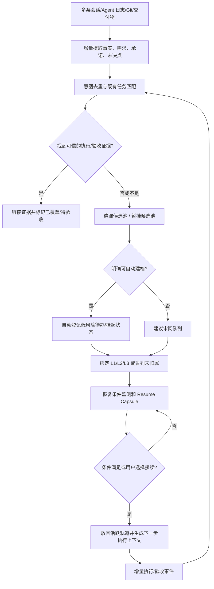
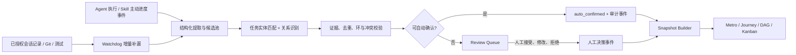

# Focus Hub v2 → v2.2：流式会话转立体任务网络与可接续推进机制（Agent 开发交接）

> **文档用途**：供另一个开发 Agent 在现有交互原型基础上继续细化和实施；这是实施规格与交接说明，不是对 v2 已有能力的承诺。  
> **版本**：2.2 · 2026-11-04  
> **基线文件**：`task_focus_hub_v2.html`（原生 HTML/CSS/JavaScript，全部脚本、样例数据内嵌；浏览器离线可用）  
> **历史设计**：`project_focus_hub_design.md`（视图概念、同步原则、阶段语义）  
> **v2.2 核心目标**：把多条流式、线性的会话及 Agent 执行记录，转化为可从 L1/L2/L3 上下钻的“立体任务推进网络”；对推进过程中被遗漏、延迟、绕过或没有交付证据的历史事项保留可恢复入口，后续按条件自动提醒或人工接续。  
> **延续 v2.1 关系治理**：Agent 可自动发现、建议及在策略允许时自动确认关系；人工可修改、拒绝、撤销，并拥有最终裁决权。  
> **数据声明**：v2 文件中的示例任务、状态、证据、进度均是演示数据，不应当作为实际项目事实。

---

## 0. 给接手 Agent 的执行摘要

目标是把大量多轮会话、跨工具/跨 Agent 工作凝聚为 **以任务为中心的持续进度总控界面**，使用户优先看见：

1. 多条会话中曾出现哪些目标、承诺与后续动作，哪些已经纳入任务网络、哪些仍在遗漏候选池；
2. 当下有哪些关键业务/技术目标；
3. 目标位于什么阶段、被什么阻塞、下一步做什么；
4. 哪些任务存在先决条件、并行、替代、协作或共同里程碑关系；
5. 能否从 L1 逐级下钻至一个 L2、再下钻至这个 L2 的一个 L3，并可靠地反向提升；
6. 关系如何被 Agent **发现→建议→有条件自动确认→人工修订**，且不破坏已有的人工判断；
7. **当用户/Agent 已向后推进，却留下未执行或未验收事项时，如何定位历史断点，稍后从该位置恢复工作而无需重读整条会话。**

**第一优先级是进度视图、上下钻和断点恢复体验。** 关系自动识别、历史遗漏挖掘是提升视图准确性的机制，不允许让系统变成一个臃肿的关系维护后台。先做“可见、可改、可信的关系”，再接大量日志源。

**明确区分六类事实：**

- **归属树**：谁属于谁，`parent_id`，一个任务只有一个主父节点；决定 L1/L2/L3 范围。
- **关系图**：任务之间的依赖、协同、替代、重复等；允许多对多，独立于归属。
- **进度状态**：任务自身所处阶段与执行状态；依赖关系不自动代表完成。
- **证据/决策**：哪条会话、提交、测试或人工指令支持关系或状态；可追溯、可撤销。
- **会话意图与未处理线索**：用户提出过的工作事项，即使尚未正式立项，也必须有可查询的候选/延期/排除记录。
- **中断点与恢复上下文**：每个暂挂任务的已完成、未完成、最后决策、下一步最小动作与接续条件。

**禁止**以“讨论出现顺序”“标题语义相似”“先完成 A 后讨论 B”直接推导 A 是 B 的前置依赖。

---

## 0.5 【v2.2 核心增量】把线性会话变成立体推进网络，恢复曾被绕过的工作

### 0.5.1 问题的本质：流式交流存在“未闭环但已经翻篇”

输入可以是不同工具、不同 Agent、不同人的若干条 **线性事件流**（conversation log / tool log / commit / artifact）：

```text
时间 →
会话 A：提出目标 P → 拆出任务 A1 → 处理 A1 → 提及 A2（暂不做）→ 继续讨论 A3
会话 B：转到实现 A3 → 出现新子任务 B1 → 遇到异常但转去优化 UI
会话 C：验证 A3 → 决策变更 → 当前主线往前走
                         └─ A2 / B1 / 验收缺口可能被遗忘
```

要求从时间流中恢复出三个相互独立的维度：

1. **目标/归属维**：业务目标或独立技术目标 `L1 → L2 → L3`，支持指定父节点下钻与反向提升。
2. **依赖/推进维**：`requires/enables/alternative/contributes_to` 等带证据的关系，形成多分支 DAG / 轨道与 Gate。
3. **时间/演化维**：要求何时出现、何时被接受、何时被绕过、何时恢复、采用了什么新决策；不能用最新摘要抹去历史。

任务是在此三维事实层上的**投影**，不是把聊天标题自动转换成看板卡片；聊天记录只是一类输入，当前状态要以可验证证据和人工决策为准。

### 0.5.2 新的独立对象：任务线索（Intent）不是正式任务（Task）

建议额外维护 `intent_candidates[]`（候选意图）与 `tasks[]`（正式任务）。Agent 可从历史会话抽出：

| 线索类别 | 识别依据 | 默认处理 |
|---|---|---|
| `untracked_request` | 用户明确提出要求，但当前任务树找不到映射 | 进入遗漏池；不能宣称已完成 |
| `deferred_work` | “先不做 / 后面补 / 有条件再做 / 暂缓” | 记录延后原因、关联父任务和恢复条件 |
| `partial_delivery` | 交付只覆盖原要求的一部分 | 记录验收差距，保留待补任务 |
| `unresolved_decision` | 曾提出方案选项，尚未形成明确取舍 | 加入决策待定池，必要时提示路线分叉 |
| `interrupted_execution` | Agent 超时、任务中断、部分文件已更改 | 标为需核验执行结果，不能简单重跑或标完成 |
| `unverified_completion` | 有“做好了”等陈述，但没有可查交付物/测试 | 证据待核验，不自动标已完成 |
| `later_superseded` | 新决策已明确替代旧要求 | 留存替代链和人工/权威来源，旧意图可归档不消失 |
| `exploratory_mention` | 一般提问、备选思考、头脑风暴 | 可保留低权重候选，不自动转为义务 |

注意 **“没有后续消息”不等于“尚未完成”**，也不等于“已经完成”。先使用任务映射、文件/测试证据、人工指令与新决策对账；若证据不足，显示 `unknown / needs_review` 而不是确定结论。

### 0.5.3 将“进度状态”与“是否已闭环”分离

至少拆分两个正交字段，避免所有不活跃任务都叫 `blocked`：

- `execution_status`：`planned | in_progress | waiting | paused | done | canceled`（执行状态）。
- `resolution_status`：`untriaged | accepted | deferred | merged_into_task | completed_verified | explicitly_dropped | needs_verification`（历史意图的处理结论）。

`deferred` 表示**明确保留未来处理**，不是 `canceled`；`paused` 表示已开展工作但暂停，不一定依赖外部前置。`completed_verified` 必须有已核验的交付证据或明确人工验收，不能只看模型信心。任务阶段（Stage）继续独立维护。

一次会话可以产生多个意图；多个意图可以聚合为一个任务（需保留所有原始引用），一个意图也可以拆成多个 L3；不应强制 1:1。

### 0.5.4 必须有“遗漏发现 → 归属匹配 → 对账 → 延后 → 重新接续”的闭环



**自动识别与自动确认边界**：

- 可自动建立**可逆、低风险**的候选意图，或将有明确证据的事项映射到已有任务；无需所有候选都阻塞主线。
- 可按策略自动确认显式的低风险任务关系（继承 v2.1 的关系治理规则）。
- **不得仅凭语义或会话先后自动认定旧任务已交付**；不得自动把历史意图标 `explicitly_dropped`，也不得悄悄改变 L1 核心目标及主归属。
- 新内容与旧人工决策冲突时，建立 `reconsideration_proposal`，不擅自回滚决定。

### 0.5.5 断点恢复对象：Resume Capsule（可接续而非简单待办）

每条延后或被中断的工作至少存储：

```json
{
  "task_id": "T-DEMO-17",
  "parent_path": ["P01", "W12"],
  "execution_status": "paused",
  "resolution_status": "deferred",
  "paused_at": "2026-11-04T03:00:00Z",
  "reason": "优先完成轨道图交互，历史日志补漏后续处理",
  "last_confirmed_decision": "当前先保证 L1/L2/L3 导航可用",
  "delivered": ["轨道图交互原型"],
  "remaining": ["对未映射的历史要求执行回填识别", "生成待复核队列"],
  "next_atomic_action": "扫描指定的、已授权的历史会话索引，产出候选意图清单",
  "resume_trigger": {"kind": "manual_or_milestone", "milestone_id": "G-DEMO-UI"},
  "evidence_refs": [{"kind":"document","source_id":"example-only","anchor":"section:requirements"}],
  "last_checked_at": null,
  "last_updated_at": "2026-11-04T03:00:00Z"
}
```

**上例全部为示例，不声称存在上述真实项目事件、里程碑或证据**。生产中 `evidence_refs` 必须是可核验的真实记录；恢复前须再次确认文件/代码实际状态，防止 Agent 从陈旧断点重复操作。

`Resume Capsule` 的最小 UI 应显示：**为何暂停 / 已完成到哪 / 剩余什么 / 恢复触发条件 / 下一步最小动作 / 来源**。原始长会话需可点击跳回，但默认无需重读。

### 0.5.6 视觉落地：主线能继续，支线可停靠，未来可返回

默认 Metro / Monster Train 视图增加 **“停靠支线（Siding / Parking）”** 的概念：

```text
                 [验收里程碑 G1] ────── [下一阶段 G2]
                       ▲
主轨道 ── [已完成 A1] ── [进行 A3] ─────────────→
              │                  │
              └── (停靠 A2)      └── (中断 B1)
                    ○                   ○
                    └─ 条件满足再接续 ─┘   （示意，非强制依赖边）
```

- 停靠分支是**恢复入口**，不是默认的真实 `requires` 边，不能错误算作关键路径或 Gate 必须通过。
- L1 只展示 `遗漏候选数 / 待接续数 / 关键缺口` 的摘要标记，防止分支噪声；L2 可以展开对应停靠支线；L3 显示具体工作与证据。
- 支线在主轨旁平行/短距离停靠，**尽量无交叉**。无法清晰布局时用“收纳袋 + 数量 + 展开面板”，不能伪造任务汇合。
- 看板增加一个可折叠的 `未闭环 / 待接续` 泳道，但不把无归属的历史意图塞进任意 L1 的 L2 子节点。
- DAG 主图仍只画已确认硬依赖；历史回溯/重新接续的轨迹采用辅助时间层、线型或详情，不与 `requires` 混画。
- 对“被绕过但继续向前的节点”，可显示轻量 `未闭环` 提示，但**不应迫使用户返回完成非阻断事项**。

建议默认总控聚焦：当前主要推进目标、关键阻塞、**3 个最值得接续的历史断点**、最近确认的决定。完整未闭环清单须按层级/来源/最近触达/风险过滤，默认折叠。

### 0.5.7 回溯范围与同步策略：先一次性历史补账，再增量维护

1. **历史 Backfill**：对用户明确授权且能够读取的历史会话、Agent 日志、任务文件和交付物进行一次性回填；输出 `已匹配/疑似未处理/历史已失效/证据不足` 四类。若数据不全，要标记扫描覆盖范围及未覆盖来源；不能声称找全了所有遗漏。
2. **增量 Watchdog**：记录 `(source_id, cursor/message_id, content_hash, observed_at)`；只处理新增或被修改内容，并定期抽样旧范围查漏。
3. **双向对账**：不仅由会话更新任务，也由 Git/测试/交付物验证会话中的“完成”宣称；已交付但尚未登记的成果可以补建任务结果。
4. **延后事项的恢复触发**：人工点击“接续”、到期日期、前置任务解锁、重要里程碑达成、同一需求再出现、关联风险升高。定期刷新不等于自动恢复执行；除非有明确自动执行授权。
5. **优先级与风险**：区分 `可择期接续` 和 `若不处理将影响验收`；逾期、风险与影响范围用于排序，但**不得仅因暂挂时间久就强制标为阻塞**。
6. **跨 Agent 冲突**：对同一意图的不同解释先聚合证据，再决定是否拆分；人工已经认定“不是任务”的事项应保留否决记录，避免反复打扰。

### 0.5.8 建议增量数据结构（与 v2.1 兼容）

新增表或逻辑集合：

| 集合 | 核心字段 | 责任 |
|---|---|---|
| `sources` | `source_id, kind, location, access_scope, scanned_until, coverage` | 记录日志来源与扫描完整性 |
| `observations` | `observation_id, source_id, anchor, observed_at, extracted_at, quote, semantic_type` | 不可变的原始证据锚点 |
| `intent_candidates` | `intent_id, origin_refs[], title, category, confidence, state, mapped_task_ids[], review_reason` | 历史意图候选及归并/驳回 |
| `tasks` | v2.1 字段 + `execution_status, resolution_status, last_progress_at, last_verified_at` | 正式工作与状态 |
| `resume_capsules` | `task_id, paused_at, reason, delivered, remaining, next_atomic_action, resume_trigger, evidence_refs, version` | 可持续恢复的工作位置 |
| `task_events` | `event_id, task_id, action, actor, occurred_at, evidence_refs, base_revision` | 状态变更、恢复、调整审计 |
| `relations` | v2.1 关系事实与版本 | 依赖、协作、替代等结构边 |

同一意图跨会话被提及，优先累积证据和引用，不重复生成任务；必要时一个意图映射多个交付任务，映射关系应显式可查。**候选意图与正式任务不得用同一个状态字段混写。**

### 0.5.9 具体样例：主线继续推进，但遗漏仍能被重新接续

以一个**示例开发项目**说明，非当前项目真实完成状态：

- 第 1 次会话：用户要求 “做 L1/L2/L3 导航；同时对旧会话遗漏做自动识别”。Agent 完成前者，因优先级决定把后者暂挂。
- 第 2 次会话：继续优化轨道图。系统看见主线继续推进，**不能**因此自动结案“历史遗漏识别”。
- 第 3 次会话：界面导航验收完成。`resume_trigger=导航验收后` 被满足，Metro 在所属 L2 出现停靠支线提示；Focus Panel 推荐“接续旧会话遗漏扫描”。
- 用户选择接续：系统加载 Capsule + 新代码状态 + 原始来源引用，在原 L2/L3 范围恢复；做完验证之后才关闭该缺口。

判定核心：**话题换了 ≠ 任务结束；有新产出 ≠ 旧要求全覆盖；暂挂 ≠ 永久放弃。**

---

## 1. 已实现基线：实测代码清单

### 1.1 文件与技术形态

- HTML：`task_focus_hub_v2.html`，约 **47 KB**、无第三方 JS/CSS 依赖、无远程请求。
- 内嵌任务数据：`<script id="seedData" type="application/json">…</script>`。
- 内部状态：`const state = {path, selected, view, focus, query, collapsed}`。
- 注册表：`registry`，从任务树生成 `task_id → {node,parent,level}`。
- 示例数据：**4 个 L1，11 个 L2，22 个 L3，12 条 `dependsOn`**（同一文件实际解析得到；状态仅供演示）。
- 支持 JSON 导入/导出，但**没有持久保存、编辑提交、Agent 接口、关系审阅、关系版本管理**。
- 暴露测试入口 `window.FocusHubTest`，当前方法为 `getState()`、`goto(id)`、`drill(id)`、`up()`、`toLevel(level)`。

### 1.2 视图功能

| 视图 | v2 已有 | 后续必须补齐 |
|---|---|---|
| A. 地铁式轨道 | 当前层节点、Stage 0–4、状态、选中/下钻 | 真实 Station/Gate、关系感知的阻塞提示、折叠后的可读性 |
| B. 关卡式路线 | 多线行进、父级汇合**示意**、节点点击 | 按真实关系和 Gate 判定汇合，`all/any/optional` 分支策略 |
| C. DAG | 从当前层 `dependsOn` 绘制简易分层边 | 独立关系存储、候选关系预览、依赖校验、跨层折叠投影、布局与防交叉 |
| D. 看板 + 折叠树 | 当前层看板、左侧全局树、折叠/导航 | 在任务卡/关系抽屉中建立和编辑关系，不改变既有归属范围 |

其他已有：右侧 Focus/Resume Panel 的基础展示、搜索、仅看重点、面包屑返回、上一级返回、树形直接定位、JSON 读写。**v2 没有真正维护持久化 Resume Capsule 或历史回溯。****不要误认为已有任务关系编辑器、历史遗漏扫描、断点恢复存储或自动同步。**

### 1.3 现有主要函数（参考代码内同名符号）

`buildRegistry`、`ref`、`scope`、`nodes`、`visible`、`select`、`drill`、`up`、`toLevel`、`gotoNode`、`renderNav`、`renderTree`、`renderMetro`、`renderJourney`、`dagLayers`、`renderDag`、`renderBoard`、`renderDetail`、`render`、`importData`、`downloadJson`。

**迁移提醒**：目前依赖数据附着在任务节点的 `dependsOn:[task_id]`，未来要迁移到独立 `relations[]` 事实表；保留旧格式兼容读入，不要同时双写两处形成“两个真相源”。

---

## 2. 用户确认过的硬约束（不得改变）

### 2.1 严格的三级父子下钻

- **L1**：全部独立一级目标，作为总览；各目标互不因视觉对称而被连到共同 Gate。
- **L2**：**选中的某一个 L1 节点**的直接子任务，不是所有 L1 的 L2 混合列表。头部必须声明 `L2 / 父 L1 ID / 父 L1 标题`。
- **L3**：**选中的某一个 L2 节点**的直接子任务；头部必须声明 `L3 / 父 L2 ID / 父 L2 标题`，并显示 L1 归属。
- **下钻**：先明确选中当前层一个有子节点的任务，再进入下一层，不允许凭层级切换标签任意跳到无上下文的 L3。
- **反向提升**：L3→L2→L1，亦可点面包屑直接提升；返回时高亮刚刚展开的那个父节点，避免迷失。
- **树形定位**：从左侧树直接定位任务时，必须恢复完整 `path`，而不只是改变 level；切换四种视图时不改变 scope。
- **跨层关系**：跨层依赖可以在关系真相表里存在，但正常的 L2/L3 可视区仍只显示当前父级的直接子节点；跨层信息放到“外部依赖摘要/边界代理节点”，不能偷偷混入其他父任务的真实节点。

### 2.2 角色与层级正交

业务目标和技术细节不是固定上下位关系。若某项技术工作具有独立价值、交付成果、验收指标、明确责任和跨任务协作需求，可独立成为 L1/L2 技术目标；一般实现步骤仍可以是 L3。不要仅凭关键词把“技术”一律放下层。

### 2.3 视觉约束

- **先显示关键事项而不是显示所有事项**。L1 默认聚焦 Active 1–2 个、Focus 不超过 5 个；L2 重点为 3–6 条主工作流；L3 为当前选中工作流的必要任务。
- **地铁轨道是默认进度总控**；Journey 负责路径/汇合，DAG 负责真实依赖与关键路径，看板负责状态和执行。
- 线色标识轨道或分支身份；状态、阻塞、关系确认度通过不同形状/线型呈现，不拿颜色承担全部含义。
- 独立项目不能被虚构成一条合流路线；只有真实共同验收的路径允许通过 Gate 汇合。
- Stage/Station 表示可验证的交付与验收状态，不以聊天次数或 L3 完成数均值代替进度。

---

## 3. 新增核心能力：Agent 识别、建议、自动确认、人工调整任务关系

### 3.1 首先区分“归属”与“关系”

**归属**是有根树：`L1 P01 → L2 W12 → L3 T121`；改变归属等于移动节点，对面包屑、数据范围和已有汇总影响很大，默认需要人审。

**关系**是图上的边：`T121 → T122` 表示后者依赖前者；即使它们分属不同父级也可以关联，但不会改变任何任务的主父级。其他类型不一定构成 DAG。

### 3.2 关系分类及执行含义

| `type` | 含义和方向 | 是否画在依赖 DAG | 默认自动确认资格 |
|---|---|---|---|
| `requires` | `source → target`：target 开始/完成前需要 source 的成果 | 是，有向，必须无环 | **有条件**：清晰明确且可核验 |
| `enables` | source 支持 target，但非硬性先决条件 | 否，可选辅助图层 | 是，低风险且高证据时 |
| `related_to` | 相关、共享资料或上下文，非依赖 | 否 | 是，前提是仅增加非阻断提示 |
| `duplicates` | 两任务可能描述同一事项 | 否，仅候选/清理队列 | 可自动建立“疑似重复”标记，**不可自动合并或删除** |
| `alternative_to` | 互斥/可替代方案，常服务于路线 Switch | 否 | 一般需人工确认业务取舍 |
| `contributes_to` | 为某 Gate/里程碑提供验收成果 | Journey/Gate | 仅结构化验收声明足够时 |
| `blocks_now` | 当前**临时阻塞**，通常是任务/外部约束对任务的影响 | 用红色阻塞提示，不等于永久依赖 | 有条件，须有明确、近期证据和有效期 |
| `parent_of` | 任务主归属（不放入普通 relations，仍用 `parent_id`） | 否 | 默认**不可自动变更** |

补充：`requires` 是长期结构依赖，`blocks_now` 是临时运行状态；“依赖 A”不等于“A 当前阻塞 B”。结构依赖存在不代表执行上必须等到 A 全部完成，需根据 `condition` 定义具体门禁。

如需 `precedes`（推荐执行顺序）应独立于 `requires`，不得因为推荐顺序而提高阻塞等级。

### 3.3 四段式状态机

```text
会话、任务描述、代码/测试、明确人工指令
             │
             ▼
   Agent 提取关系候选 + 引证
             │
             ▼
     候选关系 proposed
          ┌──┴───────────┐
          │              │
   规则允许自动确认     高影响/模糊/冲突
          │              │
          ▼              ▼
  auto_confirmed       needs_review
          │              │
          │          人工接受/修改/拒绝
          │           ┌───┴────────┐
          ▼           ▼            ▼
       有效关系   human_confirmed  rejected
          │           │            │
          └──────┬────┘            └─ 记录拒绝/禁止重复提议
                 ▼
       被人工调整/撤销 → superseded / retired
```

一个关系**至少**保存：`id, source, target, type, state, origin, confidence, evidence_refs, created_at, updated_at, actor, rationale`。建议状态集合：

`proposed | needs_review | auto_confirmed | human_confirmed | rejected | retired | superseded`

**状态与来源分开**：`actor=agent` 的关系可能自动确认；`actor=human` 的关系可能是主动添加；`human_confirmed` 后 Agent 不得静默覆盖。

### 3.4 Agent 识别流程

1. **候选任务对检索**：优先从同一父级、共享交付物、同一里程碑、代码/文件引用、明确 ID 提及、阻塞消息中召回可能有关的节点；允许跨项目，但要求更高证据。
2. **语义分类**：确定是否为硬依赖、一般关联、替代、重复或临时阻塞；多个可能类型必须给出可检验解释。
3. **证据锚定**：引用会话消息/行号、Git commit、issue、测试或人工调整事件；LLM 的“我觉得”不是证据。
4. **置信度估计**：`confidence` 属于辅助排序，不是独立执行权限。候选附 `rationale`、`supporting_quotes`（短且可定位）、`contradictions`、`impact`。
5. **约束验证**：检查节点是否存在、是否自指、是否重复、是否破坏当前已确认关系、是否形成有向环、是否触碰受保护的目标/归属。
6. **策略路由**：明确且低风险者自动确认；不清楚或高影响者进入 `needs_review`；冲突明显的候选可 `rejected` 并保留记录。
7. **重放/投影**：事件写入后更新 Snapshot，视图只读取当前有效关系，候选关系另走预览层。

**重要的识别负例**：

- “A 的讨论在 B 前面”不是 `requires`。
- “A 和 B 使用同一 Python 模块”通常只支持 `related_to`。
- “用户说 A 和 B 同时做”是并行，不等于相互依赖。
- “A 是 B 的实现细节”可能是 `parent_id` 建议，不能直接改归属。
- “A 的代码先提交、B 的代码后提交”不是必然 `requires`。
- “A 导出接口；B 明确要求接口可用后才能联调”可提出 `requires(A → B)`，有可验证定义时具备自动确认条件。

### 3.5 自动确认：允许，但必须规则化与可逆

以下是 **建议默认策略（可配置）**，不是要把所有自动识别都交给人工，也不是用单一置信度阈值决定一切。

| 条件 | 自动确认处理 |
|---|---|
| 来源直接含明确 task_id、明确“依赖/前置/必须在…之后/需要…产出”，且无冲突 | 可自动确认 `requires`（经 DAG 约束检查） |
| 结构化 Skill 写入明确 `relation.type + source + target + evidence`，来源可信 | 可自动确认 `requires` / `enables` / `contributes_to`（按证据/业务风险配置） |
| Agent 推断极高置信度，但只依据模糊措辞或时间先后 | **不得**自动确认硬依赖；仅候选建议 |
| 普通 `related_to`，不存在误触发执行阻塞，来源可靠且语义清晰 | 可自动确认，展示为低权重辅助关系 |
| 临时阻塞 `blocks_now`，具近期证据、责任方/解除条件、TTL | 可自动确认并标注过期时间，到期重新核验 |
| 可能影响关键路径的 `requires`，或跨 L1 的结构关系 | 默认审阅，可由 policy 显式授权特定类别 |
| `parent_id` 变更、目标合并/删除、L1 关键里程碑重定义 | **必须人工确认** |
| 任意类型与既有人工确认/人工否决冲突 | **必须人工确认**；不得静默覆盖 |

可在配置中引入 `confidence ≥ 0.93` 的辅助阈值和可用证据等级；**不要仅因大于阈值就自动确认 `requires`**。应同时具备 `explicitness=explicit`、可验证引用、低影响或已授权策略、无冲突、无环等条件。早期运行建议将自动确认范围限制为同一父级的明确关系，在真实语料验证后逐步放开。

**自动确认与自动修改是不同动作**：可自动新增可信的结构边；修改/删除高影响边须保留审计、冲突检测与权限。

### 3.6 人工调整与人机冲突裁决

人工至少要能：

- 新建关系：选择起点、终点、关系类型、条件，可添备注。
- 查看 Agent 建议：支持/反对证据、置信度、影响级别、一键确认/拒绝。
- 修改关系：改变类型、方向、适用条件或有效期（通过新版本事件，而非直接覆写旧记录）。
- 删除/撤销关系：删除视图中有效边，但保留历史 `retired` 事件；支持撤销误操作。
- 锁定已确认判断：显式 `protected_by_human: true` 或人工确认版本；后续 Agent 只能提出冲突建议。
- 对“Agent 为什么连这条边”获得可理解解释、来源链接和可能影响的关键路径节点。

**优先级原则**：当前人工明确指令 > 人工已确认且未撤销的约束 > 结构化可靠证据 > 经策略允许的 Agent 确认 > 单纯语义候选。若新证据与人工确认相矛盾，进入差异审阅而不是掩盖冲突。

`rejected` 必须保留拒绝的类型、节点对、理由和证据版本，以防 watchdog 每轮重提同一建议；**新的关键证据**允许重新提议，需标识与前次有什么不同。

---

## 4. 关系与视图的正确映射

### 4.1 地铁轨道（默认总控）

- 默认只显示真实任务推进位置、阻塞信号和下一步动作；**不把所有关系边铺满轨道图**。
- 当某轨道被硬依赖阻塞时，显示简洁的 `↳ 前置：T121` 或一个可展开关系计数，而不是跨整个屏幕连线。
- 点击节点在右侧显示 `前置依赖 / 下游影响 / 相关 / 候选建议` 的折叠分组。
- L1 关注“哪一个业务/技术目标受阻”，L2/L3 才逐级揭示具体前置任务。

### 4.2 关卡路线（路线与汇合）

- `alternative_to` 或方案组构成分支 Switch；需标注 `any`/`optional` 的选择条件，不让用户误以为必须完成全部分支。
- 多轨汇合必须基于明确 Gate 节点和 `contributes_to` / `gate_requires`，不能仅因同属一个 L1 自动强制连接。
- `gate_mode=all | any | optional` 需显式标记；缺失时显示为“待定义汇合”，不得暗示已经验证。
- v2 目前只是父级汇合示意；后续要以真实里程碑事实代替。

### 4.3 DAG（真实依赖）

- 仅 `requires` 关系进入主 DAG。`related_to`、`duplicates` 和 `alternative_to` 在单独图层/详情中展示，不应混进关键路径。
- **实线 + 箭头** = 已确认硬依赖；**虚线 + 问号** = 未确认建议；**线框/提示标记** = 人工修订关系（不应靠颜色单独区分）。
- “仅看确认关系 / 叠加 Agent 建议 / 仅看受阻链路”可以切换。
- 自动布局优先可读性：拓扑排序分层，尽量降低交叉；密集时聚合/折叠，不能为了视觉零交叉改变边的语义。
- 跨层关系不破坏严格 scope：用范围外依赖摘要（如 `外部前置 ×2`）+ 点击跳转；必要时显示虚拟代理点，但不把外部任务当成当前父任务的子节点。
- 高影响建议边需支持“预览如果确认会阻塞什么”，而不是自动改变当前已确认关键路径。

### 4.4 看板 + 折叠树

- 看板使用**当前父节点的直接子任务**，树形导航显示全局目录。
- 卡片增加极小的关系列表：`依赖 2 · 相关 1 · 建议 1`，默认不展开。
- 关系编辑可用右侧详情中的“管理关系”入口；先选择两个节点并指定类型，确认后更新其他视图。
- 拖放连线可以后做，且必须有非拖放的键盘可访问操作；拖动不应触发任务移动归属。

### 4.5 右侧 Focus / Resume Panel

默认优先展示：目标、下一步最小动作、关键阻塞/依赖、上次确定的决定、证据链接；对于暂挂事项必须另外展示 `为何暂停 / 完成了什么 / 还缺什么 / 恢复触发`。关系建议折叠为一行 `Agent 发现 3 条关系建议`，点击后才展示细节，避免破坏视觉聚焦。

---

## 5. 建议的数据模型（v2.1 基础 + v2.2 历史接续增量）

### 5.1 兼容策略

v2 输入为嵌套 `projects[].children[]`，节点有 `dependsOn: [id]`。新架构的**规范化形态**建议：

- `tasks[]`：`id,parent_id,title,role,stage,status,attention,next,summary,decision,evidence,updated,owner,acceptance...`
- `relations[]`：全部非归属关系的统一事实表；`source_id/target_id` 明确方向。
- `milestones[]`：可选的验收 Gate，明确 Gate 是业务节点还是展示组合点。
- `events[]`：Agent/人修改的只追加审计事件；最终快照从事件流生成。
- `intent_candidates[] / observations[] / sources[]`：历史会话/交付事实的可追溯候选池与扫描覆盖。
- `resume_capsules[]`：绕过、延后或中断事项的接续上下文，不与 `tasks[]` 或关系边混为一谈。
- `review_queue[]`：需要人工确认的候选关系与矛盾信息。
- `policies`：自动确认准入和来源可信度策略。

初期为了保持 HTML 文件简单，可以继续输入嵌套任务并增加顶层 `relations`；后端落地再转平铺 `tasks`。**一个版本只能有一个权威写入位置。**

### 5.2 关系示例

```json
{
  "id": "rel_001",
  "type": "requires",
  "source_id": "T121",
  "target_id": "T122",
  "condition": "T121 的任务识别规则已评审并固化",
  "state": "auto_confirmed",
  "origin": "agent_inference",
  "actor": "relationship-agent",
  "confidence": 0.97,
  "explicitness": "explicit",
  "impact": "low",
  "evidence_refs": [
    {"kind": "conversation", "source_id": "session-001", "anchor": "msg-42", "claim": "明确要求先固化任务识别规则再做去重"}
  ],
  "rationale": "原始要求说明 T122 的去重机制依赖 T121 规则输出",
  "protected_by_human": false,
  "created_at": "2026-11-04T02:00:00Z",
  "updated_at": "2026-11-04T02:00:00Z",
  "revision": 1
}
```

上例为**结构示例**，不是声称 `session-001` 真实存在或提供了该证据。正式代码不允许凭造出的来源 ID 自动确认。

### 5.3 建议/审批事件示例

```json
{
  "event_id": "evt_relation_003",
  "kind": "relation_decision",
  "relation_id": "rel_001",
  "action": "reject|approve|edit|retire|restore",
  "actor_type": "human",
  "actor_id": "local-user",
  "base_revision": 1,
  "reason": "仅协作相关，实际上并非强制前置",
  "patch": {"type": "related_to"},
  "occurred_at": "2026-11-04T02:30:00Z"
}
```

这里的 `action` 是**示意枚举**；实际单个事件必须写一个合法值而不是字面量 `reject|approve|...`。对同一条边连续人工修改必须维护版本号并校验 `base_revision`，避免被旧 Agent 写回覆盖。

### 5.4 校验器硬约束

1. 所有关系 `source_id` 与 `target_id` 必须存在，不允许自指。
2. 对 `(source,target,type,condition)` 做稳定去重；对无向关系规范化端点排序。
3. 所有**已确认的 `requires`** 边组成的图必须无环；候选边若加上形成环，标记冲突，不能自动确认。
4. `requires` 边方向固定为**前置任务 → 被依赖任务**。不能把“B depends on A”误存为 B→A。
5. 关联关系不自动变成依赖，状态阻塞不自动变成长期结构依赖。
6. 处于 `rejected/retired/superseded` 的边不参与 DAG、进度门禁或关键路径。
7. 人工保护的边、目标定义、主归属变动必须走人审/冲突策略。
8. 不得把不可核验的日志摘要当成 `tool_verified` 证据；可记录低级别来源供建议参考。
9. 数据导入必须验证树层级、ID 唯一性、关系端点、已确认 DAG 无环，并返回具体错误。
10. 对同一批输入二次运行推断不得重复新增同一关系或重复触发审阅（幂等）。

---

## 6. 推荐的工程结构与同步路线

```text
focus-hub/
├── README.md
├── docs/
│   └── focus_hub_agent_handoff_v2_2.md
├── dashboard/
│   ├── index.html                # 先保留 v2 单文件离线展示能力
│   └── (可选拆分的前端模块)
├── data/
│   ├── tasks.json                # 任务真相源，兼容 v2 任务树
│   ├── relations.json            # 经确认的关系 + 候选的有状态记录
│   └── milestones.json           # 真正的 Gate 定义
├── sources/
│   ├── source_index.json         # 被授权的来源及扫描水位
│   └── observations.jsonl        # 原始意图与证据锚点
├── backlog/
│   ├── intent_candidates.json   # 遗漏/未闭环候选及匹配结果
│   └── resume_capsules.json     # 挂起、恢复的任务断点
├── events/
│   └── YYYY-MM.jsonl             # 追加式更改事件
├── generated/
│   ├── snapshot.json             # 确定性投影
│   ├── relation_review_queue.json
│   └── unresolved_work_queue.json  # 历史未闭环和待接续建议
├── config/
│   ├── source-policy.yaml        # 来源访问权限和可信级别
│   └── relation-policy.yaml      # 自动确认门槛和受保护操作
├── agents/
│   ├── relationship-infer.md     # 从授权来源抽取候选关系的指令
│   ├── historical-backfill.md   # 历史线索回填与遗漏对账
│   ├── resume-task.md           # 暂挂断点恢复与证据重验
│   └── progress-update.md        # 任务状态同步指令
└── tests/
    ├── navigation.*
    ├── relations.*
    ├── backlog-and-resume.*     # 旧要求不可静默丢弃
    └── fixtures/
```

**依赖可选，不要为了架构形式牺牲单 HTML 离线运行**。早期可由本地脚本生成静态 JSON，再导入页面；当关系编辑需要持久化时，可选择本地服务/API 或“本地更改 → 导出 JSON → Agent 入库”，不要假装浏览器本地打开时已能自行写入任意磁盘文件。

### 6.1 同步主链路



- **Skill 主动更新为主**：Agent 在任务执行结束/暂挂/超时时提交可追溯状态和关系候选。
- **Watchdog 增量扫描补漏**：只读取已授权且实际可访问的来源，用 cursor/commit/hash 去重；不能假设可无权限抓取所有 SaaS 会话日志。
- **关系推断与确认层**：Agent 只负责“找候选+解释”，是否自动生效由可配置**确定性规则引擎**决定；拒绝条件不可由 Agent 直接绕过。
- **快照与界面**：任务状态、关系与未闭环队列来自事件重放；UI 只消费 Snapshot，不擅自用新消息重写目标。
- **历史 Backfill 与重新接续**：先把已授权历史对账为候选/已覆盖/待验证；未映射项在看板的收纳泳道保留并提示；每次恢复加载最新任务快照及 Capsule，避免依赖陈旧摘要。

### 6.2 多 Agent 并发边界

- 采用 `task_id/relation_id + revision + event_id` 幂等与乐观锁；需要时使用单写队列。
- 并发新增相同关系 → 归并到同一候选/已确认边，增加证据引用；不重复画线。
- 两个 Agent 对同一关系给出相反结论 → `needs_review`；不得“最后提交者获胜”。
- 人工修改后立刻设置保护版本；下一次自动扫描可以提议复议，不能自动改回。

---

## 6.3 【v2.2 优先级修订】历史遗漏与恢复能力应早于高级依赖图算法

建议将工作拆为并行但可分批验收的两条主线：

- **视觉主线（优先）**：L1/L2/L3 聚焦 → 轨道图停靠/待接续入口 → Focus Panel Resume Capsule → 手动恢复体验。
- **事实主线（跟随）**：会话意图提取 → 历史回填与任务映射 → 未闭环证据对账 → 条件触发提醒 → Agent/Skill/Watchdog 增量同步。

不要把“实现完全部关系编辑器、复杂自动布局、关键路径计算”作为遗漏识别 MVP 的前提。关系治理沿用 v2.1，但**历史未闭环可查询、可标记、可恢复**应纳入 P0/P1，而不是被推迟到装饰性功能之后。

**推荐首个可验收的 MVP**：用户手工指定一个历史会话 JSONL → Agent 输出 `意图候选+来源+是否已映射+仍需做的事` → 人工点击“暂挂/关联/接续” → L1/L2 轨道显示对应收纳入口 → 选择接续后打开 Capsule 和直接子任务 → 导出新版状态文件。无需先对接所有 SaaS 聊天记录。

---

## 7. 开发优先级（按视觉优先、关系增强、自动同步推进）

### P0：无回归地建立关系事实表 + 最小人工编辑

- 保持 v2 四视图、严格 L1/L2/L3 下钻和反向提升可用。
- 从旧版 `dependsOn` 导入 `relations`，在 DAG 投影中完全等价，不丢失旧边。
- 右侧 Focus 面板增加 `前置依赖 / 下游影响 / 相关关系 / 建议`，默认折叠。
- **v2.2 增量：展示“历史未闭环/待接续”折叠入口，并支持人工登记一个暂挂项、编辑 Capsule、从当前 L2 接续，且不破坏严格父子下钻。**
- 添加“管理关系”功能，支持手动新建、修改、撤销；暂可通过对话框或抽屉完成，勿先做复杂拖拽。
- 引入关系端点有效性、自指、去重和 DAG 无环校验。
- 导入/导出新 schema；离线打开时继续可以正常使用。

**P0 成功标志**：用户能看懂关系为何存在并修正，四视图保持一致；同时能主动把一个未完成事项暂挂、保持主线推进、稍后从指定父任务下恢复；无依赖边不会凭空出现。

### P1：Agent 候选识别、自动确认与人工建议队列

- 从**已明确提供的来源文件/事件**解析候选；初期可以从 JSONL 会话摘要 + 任务数据运行，无需先接所有外部 SDK。
- **v2.2 增量：历史回填最小闭环：提取候选 `intent_candidates`、与现有任务/成果双向对账、显示“未登记/已覆盖/待核验/延后/已放弃（须有明确证据）”，人工可一键归属、合并、暂挂或接续。**
- 候选卡显示 `类型、起点、终点、依据、置信度、影响、操作`。
- 明确关系经策略安全检查后自动确认；模糊或高影响变更进入审阅。
- DAG 中以虚线预览候选，候选关系不得改变真实阻塞状态/关键路径。
- 人工接受/调整/否决可回放，有审计记录；人工否决后不得重复骚扰。

**P1 成功标志**：同样的会话输入运行两次，不会重复创建候选/关系；可以展示至少一条自动确认、一条建议待审、一条因环而被拒绝的关系；对历史中明确暂挂但后来话题前进的事项可以找回并接续，人工纠正不会被下一轮 Agent 覆盖。

### P2：真实 Gate、跨层折叠依赖和自动事件同步

- 完成 `milestones + gate_requires + gate_mode`，替换 Journey 当前汇合示意。
- 实现折叠复合节点和跨层依赖摘要，不打破父级作用域。
- Skill 增量上报与 Watchdog 补漏；任务状态与关系事件同一事件流。
- 历史 Backfill 一次性扫描 + 增量 cursor + 覆盖率说明 + Resume Trigger，避免在已有会话推进后遗失旧线索。
- 实现溯源、版本差异、7/30/180 天变化和恢复胶囊。

**P2 成功标志**：界面可反映真实更新和关系变更，但不会因 Agent 的一段未证实文字自动标记 Gate 已通过。

### P3：高级优化（非 MVP）

自动布局、减少边交叉、智能聚合、关键路径分析、影响模拟、拖拽连线、不同项目大规模检索与推荐、多人权限控制。先有可靠事实和编辑闭环，再考虑视觉特效。

---

## 8. 核心验收用例（交给开发 Agent 逐条跑）

| ID | 场景 | 通过判据 |
|---|---|---|
| NAV-01 | L1 选 P01 下钻 | L2 只出现 P01 的直属 Wxx，标题明确标记父 P01 |
| NAV-02 | L2 选 W12 下钻 | L3 只出现 W12 的 T121/T122/T123；不得混入 W11 的 T11x |
| NAV-03 | L3 上升两次 | 先回 L2 并选中 W12，再回 L1 并选中 P01 |
| NAV-04 | 从树直接选 T122 | 自动定位 `path=[P01,W12]`，标题与节点一致 |
| VIEW-01 | 四视图切换 | scope、selected、关系事实不发生改变 |
| REL-01 | 旧 `T122.dependsOn=[T121]` 数据导入 | 转换为 `requires(T121→T122)`，DAG 方向正确 |
| REL-02 | Agent 检出明确“完成 A 才能执行 B” | 若有可核验证据且规则满足，可 `auto_confirmed`，视图显示实线 |
| REL-03 | Agent 仅推断“先讨论 A 再讨论 B” | 不能自动生成硬依赖；最多提出弱关系候选 |
| REL-04 | Agent 候选 `T122→T121` 与 `T121→T122` 成环 | 拒绝自动确认，显示冲突原因；已确认图无环 |
| REL-05 | 人工将 `requires` 改为 `related_to` | DAG 硬边消失，关系明细仍可见，保存审计事件 |
| REL-06 | 人工拒绝某条关系后重跑相同日志 | 不再重复自动生效或重新提示相同版本；新关键证据可申请复议 |
| REL-07 | 跨 L1 显式依赖 | L2/L3 不混入外部子节点，详情显示外部依赖和跳转 |
| REL-08 | 导入错误端点/自环/重复 ID | 明确报错且不破坏原有正确数据 |
| REL-09 | Agent 超高置信但证据无法核验 | 不得自动生效硬依赖 |
| REL-10 | 同一关系重复扫描两次 | 无重复边、重复事件或重复提示 |
| REL-11 | 临时阻塞到期 | 标记待重验，不能无证据无限期阻塞 |
| REL-12 | 候选关系图层关闭 | 所有未确认建议不参与当前真实进度及关键路径 |
| GATE-01 | 两条轨道没有共同 Gate | 不画虚构汇合 |
| GATE-02 | 同一 Gate 的分支要求 `any` | 不暗示所有分支都必须完成 |
| OFFLINE-01 | 直接双击 HTML 在 Edge/Chrome 打开 | 四视图、下钻/返回、关系查看等无需网络可用 |
| HIST-01 | 会话 A 提出 A1/A2，A1 完成后会话 B 只讨论 A3 | A2 保留为候选/暂挂，不能被 A3 的进展覆盖 |
| HIST-02 | 同一待办在 3 条会话重复提及 | 同一意图聚合 3 条来源，而非生成 3 条正式任务 |
| HIST-03 | 历史仅提议一种方案但并未选择 | 归为探索/待定，不自动变成必做任务 |
| HIST-04 | Agent 宣称完成、但没有交付证据 | 显示待核验，不自动 `completed_verified` |
| HIST-05 | 工作推进时暂挂非阻断事项 | 主线继续，停靠支线存在；DAG/关键路径不出现虚假硬依赖 |
| HIST-06 | 用户从 L1 → L2 选中暂挂项并接续 | 恢复原父任务路径、Resume Capsule、最新证据和下一步动作 |
| HIST-07 | 人工明确放弃旧建议，后续 Watchdog 重扫 | 不重复打扰；新证据可发复议建议但不得擅自恢复 |
| HIST-08 | 部分交付后切换话题 | 显示原验收范围与当前交付差距，保留未覆盖项 |
| HIST-09 | 某个来源未授权/日志不完整 | 标记扫描覆盖范围；不得断言“未发现遗漏=没有遗漏” |
| HIST-10 | 暂挂事项达到恢复条件 | 进入推荐接续队列，不自动执行或阻塞主线（除非有明确授权/依赖） |
| HIST-11 | Agent 子任务超时但文件已经改动 | 进入核验，而非直接标失败或盲目重复执行 |
| HIST-12 | L2 停靠事项跨到 L3 展示详情 | L3 只显示其直属子任务，跨层遗漏放在摘要/收纳面板，不污染 scope |

**浏览器测试建议**：不仅检查文件包含 JS，还要真的点击 DOM 控件，断言 `window.FocusHubTest.getState()`、关系数量、选中节点与导航路径，并拦截浏览器控制台异常。导入/编辑/导出至少做一次端到端往返测试。若无浏览器自动化环境，说明限制并运行纯 JS 数据校验测试，不可声称浏览器已验证。

---

## 9. 建议的 Agent 实现任务指令（可直接复制）

> 你正在继续开发 Focus Hub。先读取 `focus_hub_agent_handoff_v2_2.md`、`task_focus_hub_v2.html` 和 `project_focus_hub_design.md`，以现有 v2 为基线，**不要从零重画 UI 或推倒既有三级导航**。  
> 先保持四个视图、L1→指定 L2→指定 L3 和面包屑返回行为完全一致，再增量实现关系治理。  
> 把任务归属树与任务关系图分开建模；新增 `relations` 事实表和兼容旧 `dependsOn` 的迁移函数。  
> 在右侧任务面板实现关系查看、手工新增/修改/撤销以及 Agent 候选审阅。  
> Agent 可自动识别、建议、按规则自动确认关系，但自动确认必须有证据、策略约束、无环/无冲突校验；人工确认或拒绝优先且应留下审计事件。  
> DAG 只用已确认的 `requires` 画实线，候选用虚线预览；`related_to/alternative_to/duplicates` 不计入硬依赖；Journey 汇合必须绑定真实 Gate。  
> 补上历史会话→意图候选→正式任务映射和未闭环对账：对被绕过、暂缓、执行中断、验收未证实的事项生成 Resume Capsule。用户后续选择接续时，应回到原 L1/L2/L3 路径，加载最新证据并给出最小下一步动作；非阻断的历史待办不能妨碍主线继续推进。界面必须明确区分“会话推进”“任务执行”“验收闭环”，不能自动把旧要求删除或将候选直接标完成。
> 每次迭代输出：修改文件、兼容性说明、已完成/未完成清单、可复现测试结果（尤其导航、关系状态机、旧数据迁移、人工覆盖、幂等、无环、离线运行），不以“运行成功”代替具体验收结果。

---

## 10. 交付完成定义（Definition of Done）

- **可用性**：用户无需理解内部日志格式，就能在 L1 判断目标与关键阻塞，在 L2 看清工作流，在 L3 判断下一步，并原路返回。
- **准确性**：任务归属不与任务关系混淆；图上确认边有证据；未确认候选清晰区别；没有虚构 Gate。
- **可控性**：Agent 不是唯一裁决者；人能主动调整边与类型；人工否决/锁定不会被下一轮自动覆盖。
- **可追溯性**：每个重要关系有来源、状态、修改记录、版本，能够解释为什么存在、何时改变。
- **不遗漏并可恢复**：任一被识别的明确历史要求都能够追溯至“关联任务 / 延后待接续 / 证据待核验 / 明确放弃”之一；任一暂挂事项都能从原父任务路径加载断点继续。无法读取的历史范围必须单独声明。
- **兼容性**：旧版 JSON 能导入，新版可导出；原有四视图和 L1/L2/L3 功能不退化。
- **可扩展性**：自动同步来源必须基于真实授权，事实更新采用幂等事件和确定性快照，而不是让 LLM 任意覆盖前端数据。

**接手顺序**：先运行 v2 → 在 P0 实现停靠/恢复的可见闭环 → P1 增加历史意图回填及关系治理 → P2 接 Skill/Watchdog 与跨层真实 Gate → P3 才投入高级图布局。每阶段优先保证用户的视觉聚焦与决策效率。
