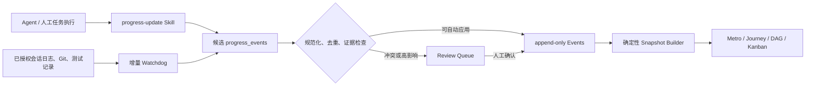

# Project Focus Hub：多任务、多会话进度总控与视觉聚焦方案

> 设计版 v0.2 · 2026-11-04 · **概念稿，全部项目状态均为示例**  
> 配套可交互原型：`project_focus_views.html`（单文件、离线运行；四视图共用示例数据，可导出/导入 JSON）。

## 0. 决策摘要

**默认主视图：A. Metro Rail（地铁轨道）**。它回答“目标推进到哪里、哪里受阻、哪里需要决策”；B. Journey（Monster Train 风格的分支汇合）用来回答“目前有哪些路线选择、何时汇合”；C. DAG 只在分析真实依赖和关键路径时打开；D. Kanban + Tree 用来完成具体任务的归属导航、审核与执行。

推荐一个总控主页、四个视图，并用一份结构化任务真相源产生四种**投影**。不要把树、DAG、轨道、时间线硬塞进一张超大图。

- **树 = 归属（parent_id）**，一个任务只有一个主归属；跨项目协作通过关联或依赖表达。
- **DAG = 先决条件（depends_on）**，可有多条依赖；必须无环。
- **轨道 = 可视化执行路径（track_id × stage_id）**，允许分支、汇合，默认不画跨轨交叉线。
- **Focus = 注意力状态（attention）**，独立于任务的执行状态（status）与阶段（stage）。
- **事件流 = 事实变更记录（progress_events）**；**快照 = 计算后的当前状态**，而不是覆盖原始会话和决定。

## 1. 四份设计参考稿

### A. 地铁式多轨进度图 · 默认总览

```text
         定义      建模      原型      验证      固化        汇合 Gate
视图交互  ●━━━━━━━━●━━━━━━━━◉────────○────────○──────╮
证据规则  ●━━━━━━━━◉────────○────────○────────○──────┼──◇ M1
日志采集  ◉────────○────────○────────○────────○──────┤
Agent恢复 ●━━━━━━━━●━━━━━━━━●━━━━━━━━◉────────○──────╯
```

- **方向**：左 → 右；阶段作为公共纵向参考列；轨道作为并行能力或交付切片。
- **信息密度**：L1 只呈现 Active 1–2 + Focus 5；L2 展示同项目 3–6 条工作流；L3 展示当前轨道的具体任务（默认 8–15 个，更多分页/折叠）。
- **视觉编码**：颜色 = 轨道身份；实线 = 已通过门禁；空心站点 = 当前阶段；浅灰 = 尚未到达；外圈 = 阻塞；虚线 = 待证实而非已达成；时效标记独立呈现。
- **汇合规则**：只有**共享同一个验收条件**的轨道允许连接到同一个 Gate。Portfolio 中独立项目不强行汇合。
- **下钻**：点击站点/轨道 → Resume Capsule；点击“下钻” → L2/L3；面包屑返回原层级、保存选择。
- **避免**：不让轨道颜色代表状态，不展示每个子任务标签，不用平均完成百分比替代门禁证据。

### B. Monster Train 式路线 / 分支选择

```text
                       ┌── [任务线 A] ── 站点1 ── 站点2 ──┐
[目标] ── [Switch] ────┼── [任务线 B] ── 站点1 ── 站点2 ──┼── [Gate]
                       └── [任务线 C] ── 站点1 ── 站点2 ──┘
```

- 用于**同一目标之下**的可选路径、并行分支、可替代实施路线或工作包集合；视觉借鉴关卡路径“选择感”，但保留企业任务管理的证据与状态语义。
- 尽可能让各分支平行、同向、在明确共同门禁处收束；路径不得隐含依赖或必须同时完成，必须单独标识 `branch_mode = all | any | optional`。
- Monster Train 类型的 **Switch（路线选择）** 与 **Merge/Gate（共同验收）** 是不同节点，不能混用；可选路线通常为 `any`，并行必需工作包通常为 `all`。
- 默认最多 6 条关键路线；其余收入下钻视图，不强行挤进屏幕。

### C. 分层依赖 DAG · 故障定位与决策

```text
                 ┌─ [任务结构] ─┐
[项目目标] ──────┼─ [采集链路] ─┼──────► [集成验收 Gate]
                 └─ [UI 投影] ──┘
```

- 顶点只表达一个具体 `task_id` 或 `gate_id`，边仅来自显式 `depends_on` / `gate_requires`。
- 关键路径突出显示，其余边按需显示；一级视图不显示 L3 技术依赖，除非它直接阻塞当前关键节点。
- 采用拓扑排序 + 分层布局；优先减少交叉而不是强行保证所有复杂 DAG 零交叉。遇到边密集时，折叠成复合节点，再局部展开。
- 不从“任务列表顺序”“先后被讨论”自动推导依赖边。

### D. Kanban + 折叠树 · 执行治理

```text
[可折叠归属树]     待处理     处理中     阻塞       待确认      完成
项目               卡片1       卡片2     卡片3     卡片4       卡片5
 ├─ 工作流A           ...        ...       ...       ...          ...
 │   ├─ 任务A1
 │   └─ 任务A2
 └─ 工作流B
```

- 树负责**找到任务**；看板负责**按执行状态处理任务**；右侧 Resume Panel 负责**知道下一步做什么**。
- 推荐状态：`待拆解`（输入阶段）→`待处理`→`处理中`→`待确认`→`完成`；`阻塞`是状态/阻塞标记；`暂缓`独立于 Focus，不要制造几十种状态。
- 卡片只放名称、状态、下一步最小动作、阻塞标记；不要把长会话摘要塞进卡片。

## 2. 三层导航与跨层上升/下钻

| 层级 | 默认节点 | 一屏信息预算 | 点击动作 | 不应出现的细节 |
|---|---|---|---|---|
| L1：Portfolio | 项目 / 独立业务目标 | Active 1–2；Focus ≤ 5；单项目一行 | 选项目进入 L2 | 技术细节、原始聊天、低优先级子任务 |
| L2：Project | Workstream / 业务能力包 | 3–6 条轨道；共享里程碑；风险摘要 | 选能力进入 L3 | 每个开发脚本、全部检查记录 |
| L3：Execution | 任务 / 必要的子任务 | 默认 8–15 项；仅显示当前链 | 打开 Resume / 证据 / 对应会话 | 全量历史上下文、无关主题 |

**跨层一致性**：L1 的“阶段”不应通过 L3 任务数自动加权平均。由目标/能力包定义自己的验收站点 `Station`，在证据满足后独立推进。L2/L3 允许超前执行，但父站点未通过时，父级不应显示“完成”。

**角色与层级正交**：

- `node_type`: `objective | capability | task | event | routine | knowledge | decision`，决定对象是什么。
- `value_type`: `business_outcome | technical_outcome | enabling_work`，决定它带来什么价值。
- `level`: L1/L2/L3+，决定放在哪一层，不能用“业务/技术”词汇自动决定。
- **技术详情可升格为业务目标**：例如“实现跨 Agent 可验证的增量状态同步”在有独立使用方、验收指标、交付成果和跨任务依赖时，属于 `technical_outcome`，可放在 L1/L2；例如“修复某个 JSON 解析 bug”通常是 L3 执行任务。

## 3. Rail 术语和进度语义

沿用历史约定：

| 术语 | 语义 | 示例 |
|---|---|---|
| `Line` | 项目或能力线路 | AgentOps Hub |
| `Track` | 并行工作流/业务能力 | 会话采集轨、证据轨、UI 轨 |
| `Stage` | 跨轨统一阶段 | 定义→建模→原型→验证→固化 |
| `Station` | Track × Stage 的交付/能力节点 | 事件 schema 完成评审 |
| `Train` | 当前推进的交付切片 / 业务能力包 | Session Watchdog MVP |
| `Carriage` | 工作包 / 必要子任务 | 增量游标、事件去重 |
| `Signal` | 进入下一 Station 的证据/门禁 | 测试通过、审批记录 |
| `Switch` | 分支路径选择或工作流切换 | Skill 主动更新 vs Watchdog 补漏 |
| `Block` | 阻断项或外部制约 | 缺少日志访问授权 |

**进度口径**：已到 Station 由最近一次**验收通过**的 Stage 决定；完成 80% 代码 ≠ 通过 Station。允许 `reopened` 事件触发回退（有依据、可审计），不允许只因近期缺少聊天而回退。

**两条时间轴**：

1. 工作进度轴：定义→建模→原型→验证→固化（“做到了哪一步”）。
2. 历史时间轴：近 7/30/180 天活动与阶段跃迁（“何时发生、停滞多久”）。

把“过去一个月发生 30 次会话”作为**活动密度**，不要当作**进度值**。

## 4. 任务识别：从大量会话抽取高价值目标

### 4.1 先识别言语行为，再决定是否创建任务

一条会话中的句子可能是：

- `COMMITMENT`：明确要求交付、完善或完成 → 候选任务；
- `DECISION`：已决定的架构与优先级 → 决策事件，不重复创建任务；
- `EVIDENCE`：代码、文件、测试、演示已完成 → 交付事实/状态变更事件；
- `IDEA`：衍生想法、临时建议 → Parking，不能自动升为主目标；
- `CONTEXT`：行业知识、参考资料、讨论 → Knowledge；
- `QUESTION`：探索性提问 → 不必自动变任务。

**任务晋升判据**（用于推荐而不是单独自动决定）：是否明确对应一个目标、是否有独立交付物、是否存在验收标准、是否有人/Agent 承担后续动作、是否跨会话持续、是否阻塞其他关键任务。具备明确交付和验收，但尚不确定的，可以提出候选任务并等待确认。用户明确提出的目标应直接建立目标锚点，不因评分低而忽略。

### 4.2 任务去重与结构维护

- 全局稳定 `task_id`，标题改写不改 ID；会话指向任务而非以会话作为任务。
- 对同一事件建立内容指纹：`source_id + message/span + event_kind + task_id`；同一文件的不同重复提及不累计进度。
- 主任务锚点 `intent.yaml` 人工保护；技术讨论、分支灵感不会自动更改 `objective`、`acceptance`、`parent_id`。
- 新任务、临时任务、派生事项分别记录，`origin` 指向触发的会话/任务。
- 未确认改动标为 `proposed`；明确冲突进入 Review Queue。

## 5. 最小数据模型（事实与视图分离）

建议仓库：

```text
project-focus-hub/
├── AGENTS.md                         # 总控与安全规则
├── .agent/skills/progress-update/    # 任务更新 Skill
│   └── SKILL.md
├── config/
│   ├── intent.yaml                   # 人工目标、优先级、范围与验收
│   └── source-policy.yaml            # 日志访问许可、来源优先级
├── tasks/
│   └── tasks.yaml                    # 稳定 ID、树结构与 DAG 依赖
├── events/
│   └── YYYY-MM.jsonl                 # 只追加进度/决策/证据事件
├── generated/
│   ├── snapshot.json                 # 确定性派生，当前状态
│   ├── focus-summary.md              # L1/L2 重点与恢复胶囊
│   └── review-queue.json             # 需确认的任务升级/冲突
└── dashboard/
    └── index.html                    # 静态轨道、DAG、看板 UI
```

**任务节点示意**（字段跨层一致）：

```yaml
id: T121
parent_id: W12
node_type: task
value_type: enabling_work
title: 任务、事件、决策类型识别
track_id: evidence
stage_id: prototype
status: in_progress
attention: focus        # active / focus / parked / background
next_action: 固化候选任务晋升规则
acceptance:
  - 可区分明确交付、已决策、探索问题和衍生想法
  - 每次状态变更带证据锚点
depends_on: []
source_refs: []
```

**事件增量示意**：

```json
{
  "event_id": "evt_...stable_hash...",
  "task_id": "T121",
  "event_kind": "artifact_produced",
  "claim": "识别规则草案已写入仓库",
  "source": {"kind": "git_commit", "repo": "...", "ref": "..."},
  "evidence_level": "tool_verified",
  "candidate_change": {"status": "awaiting_review"},
  "apply_policy": "auto_if_validated",
  "observed_at": "2026-11-04T00:00:00Z"
}
```

状态变化必须可重放、可追查至来源。对进度、状态、阻塞和决策做区分；不能因为 Agent 在日志里写“已完成”就直接标为 Gate 通过。

## 6. 跨会话与多 Agent 同步机制

### 6.1 三层链路（推荐 Skill 为主、Watchdog 补漏）



**模式 A：Skill 主动更新（主路径）**

1. Agent 启动任务时 `focus.open(task_id)`，读取目标锚点、最新进度、已确认决策、禁止重复项。
2. 执行过程中生成工作产出及可验证证据。
3. 完成/结束/超时时，`progress.update` 写入事件增量（任务 ID、事实、证据、变更建议、下一步）。
4. 验证器应用低风险变更；重要范围变更、父级迁移、目标/优先级修改需人工批准。

**模式 B：Watchdog 监控 Agent（补漏路径）**

- 读取**已授权且实际可访问**的会话导出日志、CLI 运行记录、Git 提交与测试报告；并非默认具备所有 SaaS 私有会话日志访问能力。
- 按来源保存增量 cursor/commit/hash；只处理新变化，日志更改后按指纹去重。
- 先抽取 `FACT/DECISION/TASK/IDEA`，再关联稳定任务 ID；无法确定归属则进 Inbox/Review Queue。
- 可以用 commit/webhook 触发；无法实时订阅的来源定时扫描（例如每小时一次 + 每日对账）。
- Agent 的总结仅是候选说明；真正通过门禁要检查原始证据、审批和验收规则。

**模式 C：确定性状态投影（核心）**

- `snapshot.json` 不是 Agent 随意写的自由摘要，而是用 `tasks.yaml + valid events + intent.yaml` 计算生成。
- 多 Agent 并发时通过单写者/队列/乐观版本校验避免互相覆盖；冲突无法裁决则标记 `needs_review`。
- Git 用于审计、回滚、差异；Markdown/Obsidian 用于阅读；TickTick 只同步确实需要人工在某时点处理的任务，不把全部任务镜像进去。

### 6.2 状态改变的准入等级

| 变更 | 自动应用？ | 要求 |
|---|---|---|
| 新增已验证交付物链接 | 是 | 真实路径/Commit/测试记录存在 |
| 更新“最近活动”与时间戳 | 是 | 可验证来源 |
| 低层任务处理状态 | 有条件 | 明确执行结果 + 匹配任务 ID |
| 通过 Station / Gate | 受控 | 验收标准全部满足并留存证据 |
| 更改 L1 业务目标或优先级 | 否 | 用户/负责人确认 |
| 创建关键主任务、迁移父级、删除任务 | 否 | 待审阅 |
| 推测性的进度变化 | 否 | 保留候选标注，不覆盖事实 |

## 7. Focus Panel / Resume Capsule

右侧最少展示 6 项：

1. **为什么做**：业务/技术 Outcome、当下的验收条件。
2. **上次到哪里**：最近已通过 Station；未通过时停在哪个门禁。
3. **下一步最小动作**：具体动作 + 可验证预期结果。
4. **阻塞与暂停原因**：阻塞来源、发生时间、持续时长。
5. **已确认决策 / 不要重复**：保留用户约束和不可覆盖的设计结论。
6. **证据与恢复成本**：Commit/文件/关键会话链接；预计恢复所需上下文。

**显示规则**：默认 L1 面板仅展示前 3 项和是否阻塞；进入 L2/L3 时才显示完整卡片。避免把右侧抽屉变成历史摘要仓库。

## 8. MVP 验收标准

1. 单份数据切换 Metro、Journey、DAG、Kanban + Tree，任务状态保持一致。
2. L1→L2→L3 下钻与面包屑返回都不丢失当前选择。
3. 无共享里程碑的独立项目不会被绘成汇合路径；共享 Gate 的多轨没有任意交叉。
4. 任务属于技术领域但拥有独立交付与验收时，可在 L1/L2 正确表现为 Outcome。
5. 同一条日志重复读取不会导致阶段前进两次。
6. 发现新想法只进入 Parking，不覆盖当前主任务与 Goal。
7. Agent 超时但产出已落盘时，可以凭文件/Commit 记录交付事实，而不伪称完整成功。
8. 状态任何一次跳变能回溯到证据与决策。
9. 视图可显示 7/30/180 天变化、停滞天数、阶段跃迁，但活动次数不会伪装成完成百分比。
10. 不要求连接网络即可查看已生成的 HTML，总览不能因缺少 Agent 或数据库而无法打开。

## 9. 实施顺序建议

**先完成视觉验证**：拿真实项目的 30–50 个任务匿名化，观察 L1 是否在 10 秒内识别 2 个关键关注点、阻塞及下一动作；检查 L2 共享 Gate 规则、L3 的恢复胶囊；再调整视觉密度。

**第二步固化信息契约**：固定 ID、parent、depends_on、status、attention、stage、evidence、decision、next_action 的最小字段；人工先填 1–2 个代表项目，并审阅目标锚点。

**第三步接入主动 Skill**：先让执行 Agent 稳定写结构化 `progress_events` 并确定性刷新总控视图。

**最后引入 Watchdog**：只对漏记、遗漏证据、跨会话重复与冲突做增量扫描。日志采集和语义识别要服务于既定视图，不能反过来让 UI 被日志结构绑架。

---

**原型范围说明**：可交互 HTML 当前已经实现四种视图、三级导航、轨道点击、右侧 Resume Capsule、看板树折叠、重点过滤与 JSON 导入/导出。它是视觉/交互原型，未接入实际 Git/会话日志；其中 DAG 是简化的依赖示意，不应视为真实依赖抽取；7/30/180 天历史比较、真实 Station Gate 验收与事件同步协议属于后续实现内容。
