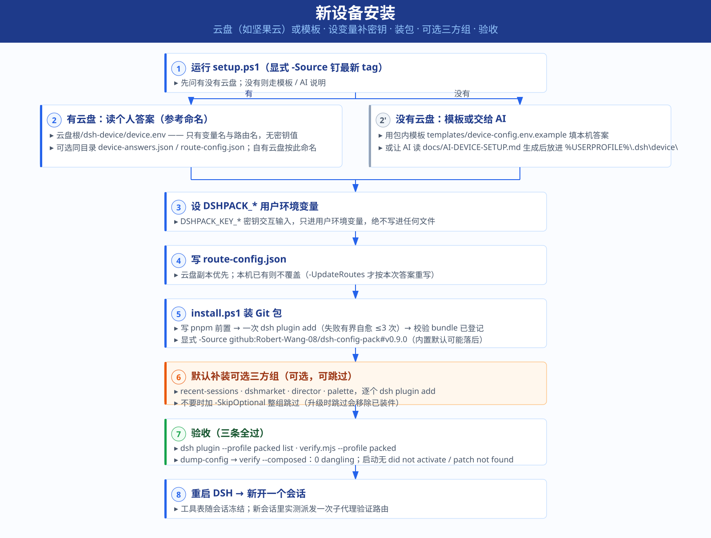
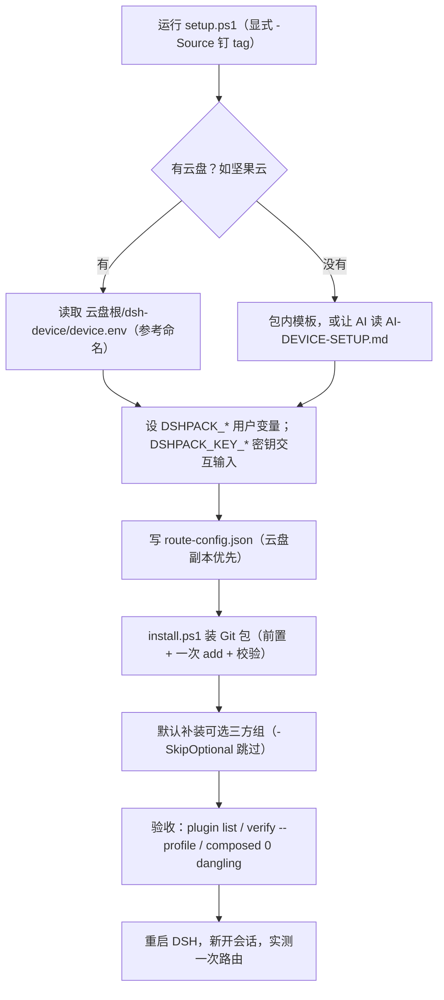
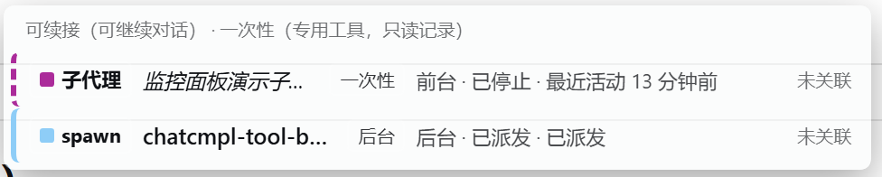

# dsh-ynm3000（superagent 通道已验证）

> **下载使用**：适合**多 provider、多 LLM、遇阻自动切换**的重度用户——在任何新/旧机器上一条命令配好四档故障转移路由（QUOTA/AUTH/限流即切）、PTC 多代理编排与会话增强插件集，只需 `pwsh dsh-config-pack\scripts\install.ps1 -ProfileName <你的profile>`（或把本仓库 README 交给 AI 代办），源与文档见 [github.com/Robert-Wang-08/dsh-config-pack](https://github.com/Robert-Wang-08/dsh-config-pack)（tag `v0.11.7`，含 `verify-install` 偏差验收与共享盘/模板两种答案方式）。**新设备装机：请让 AI 读取本 README 与 [docs/bootstrap/PROMPT-新设备装机-引导.md](docs/bootstrap/PROMPT-新设备装机-引导.md)，按引导自动完成装依赖、装 DSH、克隆仓库群、一键恢复与偏差验收。**

> **本版本（config-pack v0.11.7 · DSH 0.2.1-rc.5）能力一览**：一条命令为任意 profile 装好并钉死 16 项核心插件（官方 base/web-app/MCP 客户端 + ACP 三子代理 + provider-failover 四档故障转移路由 + 会话归档/侧栏管理/provider 徽标/子代理监控等增强）与 4 项可选三方件（recent-sessions/dshmarket/director/palette，`-SkipOptional` 可跳过），同时组合出 PTC 多代理编排预设、MCP 服务器开关、agent 预设与密钥指针配置层，全部组件锁钉不可变 tag、装完自动执行插件/配置偏差比较验收。

DSH 插件与配置的总仓库。各插件仍是独立仓库，这里只用 submodule 记下路径、远程地址和当前提交。

克隆：

```powershell
git clone --recurse-submodules https://github.com/Robert-Wang-08/dsh-ynm3000.git D:\src\dsh
# ↑ D:\src\dsh 只是源设备的安装实例（示例路径），按本机实际选择，后续命令同步替换。
```

已关联：

- `dsh-archived-sessions`
- `dsh-config-pack`
- `dsh-permission-compat`
- `dsh-plugin-provider-badge`
- `dsh-plugin-sidebar-visibility`
- `dsh-provider-failover`
- `dsh-superagent`（维护 fork `Robert-Wang-08/dsh-superagent-prototype`，原上游 `deepseek-ai/dsh-superagent-prototype` 保留为 `upstream`；独立服务，不是插件：以 `link:` 装进**独立 profile `superagent`**，端口 3082；装机、补丁与验收见 [docs/ops/superagent-profile.md](docs/ops/superagent-profile.md)）
- `dsh-wechat-hitl`

`dsh-wechat-hitl` 不走 `link:`：它以**目录副本**装进 `profiles/{web,headless}/node_modules/dsh-wechat-hitl`，再由该 profile 的 `cordis.patch.yml` 里 `- insert: wechat-hitl` 挂载（片段由 `dsh-wechat-hitl/tools/switch-hitl.mjs` 管理，路径跟随 `DSH_HOME`）。因此改代码后要**重新拷一次**到 profile，不像 `link:` 插件那样 `git pull` 即生效。装机与验收步骤见 [docs/bootstrap/PROMPT-新设备装机-引导.md](docs/bootstrap/PROMPT-新设备装机-引导.md) 第 5 步。

下面四份还没有独立远程仓库，源码直接放在本仓库里：

- `dsh-plugin-new-session`
- `dsh-plugin-ptc-switches`
- `dsh-plugin-subagent-monitor`
- `dsh-subagent-acp-resilient`

根目录的 `dsh-menu.ps1` 是本机运维入口。公开发布的一键安装仍走 `dsh-config-pack` 的 GitHub tag，不从本仓库安装。

## Superagent 定期健康报告

仓库脚本服务已提供心跳/组件状态、实际响应模型、今日关联会话、可追溯recap、未完成与工单人工事项，以及SQLite可靠发送队列。默认发送关闭；核实管理人和bot绑定后可安装每分钟采样任务。独立于DSH profile，无需重启宿主。

运行、绑定、验收与回滚见 [健康报告操作手册](docs/ops/superagent-health-report.md)；服务入口为 [service.py](tools/superagent_health/service.py)。dashboard用量保持可降级：认证和worker扫描覆盖未满足时不报告完整消耗金额。

## 新设备安装

在 `dsh-config-pack` 里一条命令。有共享盘就读已经填好的答案；没有就用包内模板，或把说明交给 AI。然后装包、写路由、设置用户环境变量。密钥不进答案文件。

**让 AI 自动配置（推荐入口）**：把 [`docs/bootstrap/PROMPT-新设备装机-引导.md`](docs/bootstrap/PROMPT-新设备装机-引导.md) 整段交给新设备的 AI 代理执行——它覆盖装依赖、装 DSH（钉 `0.2.1-rc.5`）、克隆本仓库群、从共享盘一键还原、验收与报告。三方插件（recent-sessions / dshmarket / director / palette）默认安装，prompt 里有 `-SkipOptional` 跳过开关。

没有共享盘、交给 AI 时，让 AI 读 `dsh-config-pack/docs/AI-DEVICE-SETUP.md`。生成的文件放到 `%USERPROFILE%\.dsh\device\`，再重新运行下面的命令。

共享盘答案的**参考位置**：云盘同步根（本机安装实例名为 `Skill+Tool\skillhub`）下的 `dsh-device`（`device.env` 和 `route-config.json`），不提交到 Git。「SkillHub」只是本方案的参考名称——你的云盘叫什么都行，`setup.ps1` 只认 `dsh-device\device.env` 这个约定（可选 `device-answers.json` / `route-config.json`）。日常 profile 是 `web`。`web-restore` 只在本机做验证，不作为提交内容。



英文图：[setup-flow_v2_en.svg](attachments/setup-flow_v2_en.svg)

```powershell
pwsh -File dsh-config-pack\scripts\setup.ps1 -Source 'github:Robert-Wang-08/dsh-config-pack#v0.11.7'
```



## 已安装设备一键更新

双机装好之后，插件与配置层升级**不需要重跑安装流程**，一条命令同步到远端最新发布版本：

```powershell
pwsh -File dsh-config-pack\scripts\update.ps1                     # packed profile，自动取远端最新 tag
pwsh -File dsh-config-pack\scripts\update.ps1 -ProfileName <p>    # 指定 profile
pwsh -File dsh-config-pack\scripts\update.ps1 -SkipOptional       # 不动可选三方组
```

`update.ps1` 做：解析远端最新发布 tag → 与本机已装版本比较（已是最新直接退出，`-Force` 强制重跑）→ 复用 `install.ps1` 全流程（pnpm 前置 + pack 与可选组一次多 spec add + 组件 bundle 显式登记 + lib 构建 + `verify-install` 偏差比较验收）。更新完成后**重启 DSH 并新开会话**（工具表随会话冻结）。

边界：设备个人答案与密钥不动（密钥只在用户环境变量）；云盘 `route-config.json` / 个人答案有变更时用 `pwsh scripts/setup.ps1 -UpdateRoutes` 同步路由；源设备 `web` 这类 link: 开发态 profile，`git pull` + 重启即生效，不走本流程。

## DSH 收口备份与一键恢复

「收口备份」= 把工作区（根仓库 + 全部子仓库）未提交的改动按显式路径提交，同时把**全部 profile** 打成一份可跨机恢复的 bundle；换机时用 `dsh-restore.ps1` 一键恢复。备份与恢复入口都在仓库根目录。脚本动态发现根目录下带 `.git` 的仓库（当前根 + 7 个子模块），工作区之外的兄弟检出（`D:\src\dsh-superagent`）用 `-IncludeSiblingRepos` 纳入、`focus-hub` 用 `-IncludeFocusHub` 纳入：

```powershell
# 只盘点（不备份、不提交）
pwsh -NoProfile -File .\dsh-commit-backup.ps1 -Status

# 收口备份：全 profile bundle + 提交 + 推送（一句话入口）
pwsh -NoProfile -File .\dsh-commit-backup.ps1 -Push -Message "chore: 收口备份"

# 恢复：默认只出计划；确认后写回（每个 profile 先写 pre-restore 安全快照）
pwsh -NoProfile -File .\dsh-restore.ps1 -List
pwsh -NoProfile -File .\dsh-restore.ps1 -Snapshot <bundle 目录>
pwsh -NoProfile -File .\dsh-restore.ps1 -Snapshot <bundle 目录> -Apply -AllowPartial

# 可选：只备份当前 profile（旧行为）；请求隔离安装演练
pwsh -NoProfile -File .\dsh-commit-backup.ps1 -SingleProfile -Message "chore: 单 profile 备份"
pwsh -NoProfile -File .\dsh-commit-backup.ps1 -RehearseOnline -Push -Message "chore: 收口"
```

- **完成判据**：退出码 0 **且** 回执 `.ptc\reports\commit-backup-<UTC>.json` 的 `backup.status=ok`（`bundle.json` 可读、`failed=0`）。只看到「备份完成」一行不算。
- **bundle 布局**：`%USERPROFILE%\.dsh\backups\dsh-backup-<时间戳>\profiles\<profile>\` 下每个 profile 一份 `dsh-snapshot/v1`，根目录 `bundle.json`（`schema=dsh-backup-bundle/v1`）；默认启动 profile 仍是 `web`，恢复不改启动命令。
- **范围**：profile 配置与插件数据；凭据值、会话、附件、日志、`node_modules` 不进快照。未加 `-Rehearse` 的备份是 partial，写回必须显式 `-AllowPartial`。
- **引擎门槛**：`engine-preflight` 为 `conflict` 时恢复硬阻断；`drift` 需人工确认后加 `-AcceptEngineDrift`。
- **提交纪律**：先子仓库、根仓库最后；只暂存 `git status` 解析出的显式路径（不执行 `git add .`）；凭据文件、`.ptc/`、`.tmp-*`、`downloads/` 等本机产物永不入库；从不 force push。
- 配置包单入口仍可用：`dsh-config-pack\scripts\dsh-backup.ps1 backup -AllProfiles` / `restore -AllProfiles -Snapshot <目录>`。

一句话版本说明见 [docs/ops/DSH-一键备份与恢复-简要说明.md](docs/ops/DSH-一键备份与恢复-简要说明.md)；完整参数、排除规则与已知限制见 [docs/ops/一键提交与备份.md](docs/ops/一键提交与备份.md)；换机步骤见 [新设备装机引导](docs/bootstrap/PROMPT-新设备装机-引导.md)。

## git 巡检自动化（git-watchdog）

独立 Windows 计划任务检查 gitsync 清单中的本机仓库与 DSH 一键备份滞留；superagent 服务停机仍可运行，不依赖任何 profile。

```powershell
# 手动离线巡检，完整 JSON 回执（报告与日志照写）
pwsh -NoProfile -File .\dsh-git-watchdog.ps1 -DryRun -Json
# 先看计划，再注册；移除用 -Remove
pwsh -NoProfile -File .\dsh-git-watchdog-register.ps1 -DryRun
pwsh -NoProfile -File .\dsh-git-watchdog-register.ps1
pwsh -NoProfile -File .\dsh-git-watchdog-register.ps1 -Remove
```

work 组只做本地检查并提醒；personal/thirdparty 干净且落后时才受限快进，脏或领先则提醒管理人；引擎 drift/conflict 时完整 report-only。配置、提醒渠道、退出码与跨设备操作见 [git 巡检运维说明](docs/ops/git-watchdog.md)。

Windows 快捷入口：`launch-superagent.cmd` 默认委托现有服务脚本启动 superagent 并打开管理页；`launch-superagent.cmd status` / `url` 可查询状态或地址。它不会构建代码或安装插件。新改动只有在子仓库成功推送、远端可读取该 SHA 后，才能更新并推送根仓库的子模块指针。

## 能力清单（逐组件：用途与 fix 原因）

### 自写插件

| 组件 | 钉的版本 | 能力（做什么用） | fix / 为什么自写 |
|---|---|---|---|
| `dsh-provider-failover`（发布包名 `dsh-deepseek-keypool`） | 3.8.3 | **provider 故障转移路由**：四档 tier（codex-relay → openai-codex → ais/opencode-go → kimi），QUOTA/AUTH/限流/传输错误自动切下一档，每回合最多 6 次；挂 notice 通知 | 近期 fix：隔离 base route 观察避免误判 failover 目标（e3beef1）、补通知客户端渲染回归并记录「通知不可回看」已知缺口 |
| `@local/dsh-subagent-acp-resilient` | 0.2.3 | 上游 ACP 子代理的**替换实现** | 自写原因：上游在慢响应时误判空闲超时、超时诊断被丢弃、已改文件对模型不可见——本实现给分级超时阶梯（进程 30s/建立 60s/空闲 3min/普软硬 10-20min/复杂 20-45min，`PTC_ACP_*` 可覆盖）+ `guardWorkspaceReuse` + 修 HTTP/1.1 |
| 外部 CLI 调用（ACP 子代理 + 派发工具） | — | 会话里可直接把 **cursor-agent、opencode、kimi、codex（official）** 等本机 CLI 当子代理用：`DSHPACK_ACP_OPENCODE/KIMI/CURSOR` 开关 + `tool/ptc-dispatch` 派发，由 subagent 路由选人（面板徽标显示实际路由） | ⚠️ CLI 长任务**等待容易超时**——已有分级超时阶梯缓解，超时时诊断与已改文件仍会回传模型，但重型任务建议拆小或转后台 |
| `dsh-plugin-sidebar-visibility` | 0.0.7 | Web 侧栏九项增强：工作区隐藏/折叠/拖拽排序、工作区行新建会话、会话重命名/分叉/归档、收藏+仅收藏筛选、运行中转圈标识、插件列表↔原始列表热切换、Provider 挂起/恢复 | 状态持久化在 localStorage 单键，与官方侧栏同一惯例；官方无这些 API，天然做成本地视图 |
| `dsh-plugin-provider-badge` | 0.4.0 | 模型选择器前的 provider 徽标（颜色 swatch 与文字分离，不依赖颜色辨识）。composer 实拍： | — |
| `dsh-plugin-subagent-monitor` | 0.1.0 | 会话头部「子代理 N」面板：类型徽标**优先显示实际路由**（provider/model，如「Codex-Relay (codex-relay / gpt-5.6-sol)」）+ keepalive 活性 + 后台任务实时输出环 + 一键打开子会话 | 自写原因：官方 UI 只显示任务描述看不出是哪个子代理、后台 job 输出环为空、活性无展示；本插件为只读可见性增强，不写任何数据 |

子代理面板实拍（演示会话：1 个前台子代理 + 1 个后台 spawn 任务）：


| `dsh-plugin-ptc-switches` | 0.2.0 | PTC 开关的热切换 UI（不改配置文件即可开关各模式） | — |
| `dsh-plugin-new-session` | 0.2.0 | 会话内一句话开**独立顶层会话**（等价 GUI「新建会话」，不是 subagent）：`new_session` 调 `sessionController.create/rename/prompt`，默认继承当前会话的**工作区**，可带标题与首条消息；配套项目级 skill `new-session` | 官方把该能力只留给 GUI 的 `session/create` RPC，agent 工具集里没有，自写补齐 |
| `dsh-permission-compat` | 0.1.0 | **宿主补丁工具**：直接改写已装 dsh 模块（sandbox/pwsh/bash/fs）修宿主权限行为 | 不能作为 `dsh plugin` 依赖安装（带外 apply/verify/revert，带 .bak 备份），锁里标 `installable: false` |

`dsh-plugin-new-session` 在新设备上登记一次，之后 `git pull` 即得后续更新
（登记是 `link:` 依赖，指向本仓库目录，不复制代码）：

```powershell
git -C D:\src\dsh pull
dsh plugin --profile web add D:\src\dsh\dsh-plugin-new-session
# 重启 dsh web，并新开一个会话（工具表在会话启动时生成）
```

### 上游 fork（本地改动领先上游）

| 组件 | 钉的版本 | 能力与 fix 原因 |
|---|---|---|
| `dsh-archived-sessions` | 0.4.4 | 会话归档列表/查看器/删除。0.4.3 把 peer/dev 依赖升到 DSH 0.2.1-rc.5，0.4.4 重写 lockfile 让 frozen install 通过；走本仓库 tag 而不是 npm |

归档界面（截图来自子模块仓库，钉 v0.4.1）：


### 第三方插件（按上游维护，本包只消费版本号）

| 组件 | 钉的版本 | 能力 |
|---|---|---|
| `dsh-chat-import` | 0.25.2 | 外部聊天记录导入（interchange v1） |
| `dsh-mermaid-smooth` | 0.1.0 | mermaid 图渲染体验优化 |
| `dsh-notify-bell` | 0.12.0 | 桌面通知铃（上游无 repository 字段，按 npm 包名+版本定位） |
| `dsh-embedded-browser` | —（当前 profile 未启用） | **右侧栏内嵌浏览器**：一个 Chromium 跑在 DSH 宿主里，每个会话有自己的标签页；AI 用 `browser_embedded_*`（CDP）读页/点击/填表/截图，人在右侧栏同一个标签页里接管（登录、扫码、短信码、CAPTCHA），所有会话共享一个持久 profile，登录一次到处可用。当前 web/packed 均未登记该插件，以下配置仅启用时参考 |

内嵌浏览器在本机有两处必须显式配置的差异（换设备先核对，否则插件装了也不工作）：

1. **`browserPath`**：上游自动探测只沿 Linux 的 `PATH` 找 `google-chrome-stable` / `chromium` 这类名字，再退回
   `~/.cache/{ms-playwright,puppeteer}`。Windows 两处都不命中，启动时直接抛
   `no Chrome/Chromium binary found` —— 必须显式给 Chrome 可执行路径。
2. **`lazyTools`**：默认 `true` 时 10 个 `browser_embedded_*` 工具被 `browser-use` 技能门闸挡在门后
   （`lib/lazy.js` 里 `SKILL_NAME` 硬编码）。本机没装该技能，门闸永远不开，模型只会说工具不存在；
   设 `lazyTools: false` 改成加载即注册。日后装了 `browser-use` 技能可删掉这一行回到懒注册。

两处都写在 profile 的 `cordis.patch.yml`（`- id: embedded-browser` 整键覆盖 config）：

```yaml
- id: embedded-browser
  config:
    browserPath: 'C:\Program Files\Google\Chrome\Application\chrome.exe'
    lazyTools: false
```

改完必须**重启 DSH 并新开会话**（工具表在会话启动时生成，旧会话看不到新工具）。

### 可选三方组（默认装，`-SkipOptional` 整组跳过；清单见 `assets/optional-components.json`）

| 组件 | 钉的版本 | 能力 |
|---|---|---|
| `dsh-recent-sessions` | v0.1.2 | 最近会话列表（huangxp12/dsh-recent-sessions） |
| `dshmarket` | v1.66.21 | 插件市场面板 |
| `dsh-plugin-subagent-director` | 0.6.0-beta.2 | 子代理调度增强 |
| `dsh-palette` | 0.2.1 | 调色面板 |

### 配置层能力（本包 patch + 组合锁提供）

- **四档 provider 故障转移路由** + `subagentRouting` 分工链（设计/开发/验证/长连续各有候选顺序）
- **ACP 路由开关与超时阶梯**（`DSHPACK_ACP_OPENCODE/KIMI/CURSOR`）
- **4 个 MCP 服务器开关**：codegraph（默认关，需自备）、ticktick（设入口即开）、腾讯文档/幻灯片（需 token）
- **agent 预设注册表** + 默认 provider/model（`DSHPACK_DEFAULT_*`、`DSHPACK_SELECTED_PRESET`）
- **密钥指针**：`DSHPACK_KEY_*` 只写引用名，真实值在用户环境变量，装完打印缺失清单
- 每个组件**钉不可变 annotated tag + 解引用 commit**（`verify-components` 联网强制），装完跑 `verify-install.mjs` 偏差比较验收

## 插件与 Bundle 登记（2026-11-10 基线：DSH 0.2.1-rc.5）

> 本节是当前工作区与 `web` profile 的权威登记。新增、升级、替换或停用插件，以及调整 profile bundle 顺序时，必须同步更新本节；未更新视为变更未完成（见 `AGENTS.md` §10）。
> “兼容 DSH”优先取 `peerDependencies` / `engines`；没有显式声明的写“运行时验证”。

### 宿主与核心包

| 组件 | 版本 | 兼容 DSH | 说明 |
|---|---|---|---|
| `@deepseek-ai/dsh` | 0.2.1-rc.5 | 基线 | 宿主本体（`dsh --version`） |
| `@deepseek-ai/dsh-base` | 0.2.1-rc.5 | 精确 | 核心 bundle：agent loop、tools、session、settings、permissions |
| `@deepseek-ai/dsh-web-app` | 0.2.1-rc.5 | 精确 | Web UI、host webserver、client |
| `@deepseek-ai/dsh-experimental-auto-review` | 0.2.1-rc.5 | 精确 | 自动 review bundle |
| `@deepseek-ai/dsh-mcp-client` | 0.2.1-rc.5 | 精确 | MCP client bridge |
| `@deepseek-ai/dsh-subagent-acp` | 0.2.1-rc.5 | 精确 | ACP 子代理后端 |
| `@deepseek-ai/dsh-subagent-claude-code` | 0.2.1-rc.5 | 精确 | Claude Code 子代理 |
| `@deepseek-ai/dsh-subagent-codex` | 0.2.1-rc.5 | 精确 | Codex 子代理 |

### 工作区与第三方插件

| 插件 | 版本 / 钉定 | 兼容 DSH | 启用位置 | 最近变更历史 |
|---|---|---|---|---|
| `dsh-config-pack` | 0.11.7 @ `6e4ac9d` | peer base/web-app = 0.2.1-rc.5 | web、plugintest、superagent、packed | 0.11.7 多 profile bundle 与恢复；0.11.6 adapter/公共通道分表；2026-11-10 provider 字面量与旧设备变量迁移；2026-11-13 刷新模型目录并修正元数据说明 |
| `dsh-deepseek-keypool`（仓库 `dsh-provider-failover`） | 3.8.3 @ `29c7309`（最新 tag v3.6.0） | 运行时验证 | web、plugintest、superagent、packed | 3.8.3 裸 HTTP/2 stream 失败恢复；3.8.2 原始错误与定时重试状态；3.8.0 设置页列出全部 key |
| `@jiangdaoli/dsh-archived-sessions` | 0.4.4 @ `fffe92f` | peer 精确 0.2.1-rc.5 | web、plugintest、superagent | 0.4.4 重写 lockfile 通过 frozen install；0.4.3 peer/dev 升级到 0.2.1-rc.5；0.4.1 适配 DSH 0.2 |
| `@local/dsh-plugin-sidebar-visibility` | 0.0.7 @ `64eda5c` | 运行时验证 | web | v0.0.7 未读亮点；v0.0.4 非当前会话运行行模型色；v0.0.3 rc.2 目录树与运行中转圈 |
| `dsh-plugin-provider-badge` | 0.4.0 @ `2a69c5f`（tag v0.3.1） | 运行时验证 | web | 0.4.0 当前工作区版本；v0.3.1 额度参数与徽标配置；v0.3.0 常用模型一键切换 |
| `@local/dsh-subagent-acp-resilient` | 0.2.3（root 仓库跟踪） | peer 精确 0.2.1-rc.5 | web、plugintest、superagent、packed | 0.2.2 把上游 cause 明细透传；0.2.3 当前兼容版本 |
| `dsh-plugin-subagent-monitor` | 0.1.0 @ tag `v0.1.0` | 运行时验证 | web | v0.1.0 子代理面板：实际路由徽标、keepalive、后台输出环、打开子会话 |
| `dsh-plugin-subagent-director` | 0.6.0-beta.2 | 运行时验证 | web | 0.6 beta：按角色/调用参数选择 provider/model |
| `dsh-plugin-new-session` | 0.2.0（root 仓库跟踪） | 运行时验证 | 工作区登记；当前 profile 未启用 | 0.2.0 `new_session` 创建独立顶层会话 |
| `dsh-plugin-ptc-switches` | 0.2.0（root 仓库跟踪） | 运行时验证 | packed | 0.2.0 PTC 模式热切换 UI |
| `@local/dsh-ptc-multi-agent-mode` | bundle 0.3.0（公共源 v0.16.1） | 运行时验证；声明依赖仍写 0.2.0-rc.2 | web、packed | 可移植 PTC 多代理预设与 Codex/Kimi/Claude/OpenCode/Cursor 路由 |
| `@local/dsh-preset-failover-tiers` | 0.1.0 @ `b373d1a` | 运行时验证 | web、plugintest | v0.1.0 便携档位表：模型族对齐 tier + transport-safe 终止码 |
| `dsh-codex-cred-sync` | 1.0.0 @ `8f4586e` | 运行时验证 | web、plugintest | v0.1.0 同步 `llm-pi-ai/<provider>` 与 `~/.pi/agent/auth.json`，最新过期时间优先 |
| `dsh-permission-compat` | 0.1.0 @ `a8e7e8b` | 0.2.1-rc.5 安装钉适配 | 带外工具，不挂 profile | 0.1.0 适配 0.2.1-rc.5 安装钉与诊断补丁 |
| `dsh-superagent` | 0.1.0 @ `c0b7df4`（维护 fork） | engines dsh `^0.2.1-alpha.2`，0.2.1-rc.5 满足 | 独立 profile `superagent`，端口 3082 | 2026-11-13 原有 Feishu 回复修复已推送维护 fork：私聊不带 reply-in-thread，前导 @ 避免 CLI 文件展开；不含缓存兜底；Windows `stateDir` 绝对路径补丁见 `docs/ops/superagent-profile.md`；恢复核实与设置补录见 `docs/ops/superagent-restore-20261110.md` |
| `dsh-plugin-eye-care-bg` | 0.1.0（root 仓库跟踪） | 运行时验证（无 peer/engines 声明） | 仅 `superagent`（3082 面板） | 0.1.0 护眼页面底色 `#C7EDCC`：纯客户端 CSS 注入，覆盖主题令牌 `--dsw-alias-bg-base`，不注册端点、不持凭据 |
| `dsh-wechat-hitl` | submodule（HEAD `91b11ed`；workspace package 无 `version` 字段） | 运行时验证（无 `peerDependencies` / `engines` 声明） | web、headless、superagent、plugtest（目录副本 + `- insert: wechat-hitl` 挂载） | 2026-11-14 更正本行：已是带 `.git` 的子模块，且四个 profile 的 `cordis.patch.yml` 均挂载（旧记「无 `.git`、未在 web 挂载」已失准）；2026-11-13 入站去重、出站配置阻塞与失败留痕加固 |
| `dsh-chat-import` | 0.25.2（npm 最新 0.26.4） | peer dsh `>=0.1.5-rc.1` | web | 外部聊天记录导入，保留工具调用/推理/结果 |
| `dsh-mermaid-smooth` | 0.1.0 | 运行时验证 | web | Mermaid 默认渲染与平滑缩放/平移 |
| `dsh-notify-bell` | 0.12.0 | 运行时验证 | web | 语义通知音：完成/阻塞/权限/提问/错误 |
| `dsh-palette` | 0.2.1 | 运行时验证 | web | Command palette（⌘K） |
| `dsh-recent-sessions` | 0.1.2 | 运行时验证 | web | 跨工作区最近会话面板 |
| `dshmarket` | 1.66.21 | 运行时验证 | web | 插件市场面板 |
| `dsh-embedded-browser` | —（当前 profile 未启用） | 未验证 | 未启用 | 历史登记；启用时需配置 `browserPath` 与 `lazyTools` |
| `ds-harness-remote` | 0.6.4（npm registry，无 `engines.dsh` 声明） | 运行时验证（0.2.1-rc.5 启动、`--dump-config` 均通过；上游自述基线 `0.2.2-rc.1`，保留 0.2.1-rc.5 载体） | **无 — 2026-11-12 停用（`web` 从未启用）** | **2026-11-12 登记「不再使用」并清理**：从 `plugtest` 卸载（`dsh plugin remove`，依赖/bundle/`node_modules` 三层已核对为空），删除 `~/.dsh/ds-harness-remote` 设备私钥与服务器凭据，账号侧设备吊销待用户在 Remote 客户端操作。停用理由：默认全开 `terminal`/`remoteTools`/`hostControl`/`codex`/`acp`，配对即等同交出 Host 全权，且私钥明文落盘受 `CodexSandboxUsers` 可读 ACL 影响；本机无远程访问刚需。历史：2026-11-10 首次安装并验证（侧栏「Remote」入口、Host 身份与 Noise 握手正常，账号未登录故未建立隧道） |

### Bundle 清单（web profile，按加载顺序）

| # | Bundle | 版本 / 来源 | 包含内容 / 作用 | 兼容 DSH |
|---|---|---|---|---|
| 1 | `@deepseek-ai/dsh-base` | 宿主 0.2.1-rc.5 | agent loop、tools、session、settings、permissions | 精确 |
| 2 | `@deepseek-ai/dsh-web-app` | 宿主 0.2.1-rc.5 | Web UI、host webserver、client | 精确 |
| 3 | `@deepseek-ai/dsh-subagent-claude-code` | 0.2.1-rc.5 | Claude Code 子代理 provider | 精确 |
| 4 | `@deepseek-ai/dsh-subagent-codex` | 0.2.1-rc.5 | Codex 子代理 provider | 精确 |
| 5 | `dsh-codex-cred-sync` | 1.0.0 @ `8f4586e` | DSH 凭据引用与 pi agent auth 同步 | 运行时 |
| 6 | `dsh-chat-import` | 0.25.2 | 外部聊天记录导入与反向导出 | 运行时 |
| 7 | `dsh-mermaid-smooth` | 0.1.0 | Mermaid 渲染增强 | 运行时 |
| 8 | `@local/dsh-plugin-sidebar-visibility` | 0.0.7 @ `64eda5c` | 侧栏隐藏/折叠/排序/收藏/运行状态 | 运行时 |
| 9 | `dsh-notify-bell` | 0.12.0 | 语义通知音 | 运行时 |
| 10 | `@jiangdaoli/dsh-archived-sessions` | 0.4.4 @ `fffe92f` | 归档列表、查看器、删除 | peer 精确 |
| 11 | `dsh-deepseek-keypool` | 3.8.3 @ `29c7309` | provider 分档故障转移与 key 轮换 | 运行时 |
| 12 | `dsh-plugin-provider-badge` | 0.4.0 @ `2a69c5f` | 模型选择器 provider 徽标 | 运行时 |
| 13 | `@local/dsh-ptc-multi-agent-mode` | bundle 0.3.0 | PTC 多代理预设与路由 | 运行时；声明 0.2.0-rc.2 |
| 14 | `@local/dsh-preset-failover-tiers` | 0.1.0 @ `b373d1a` | provider failover 档位表 | 运行时 |
| 15 | `@deepseek-ai/dsh-experimental-auto-review` | 宿主 0.2.1-rc.5 | 自动 review | 精确 |
| 16 | `dsh-palette` | 0.2.1 | 命令面板 | 运行时 |
| 17 | `dsh-recent-sessions` | 0.1.2 | 最近会话面板 | 运行时 |
| 18 | `dshmarket` | 1.66.21 | 插件市场 | 运行时 |
| 19 | `dsh-plugin-subagent-monitor` | 0.1.0 | 子代理/后台任务可见性 | 运行时 |
| 20 | `dsh-plugin-subagent-director` | 0.6.0-beta.2 | 子代理 provider/model 调度 | 运行时 |
| 21 | `dsh-config-pack` | 0.11.7 @ `6e4ac9d` | profile patch 层、agent 预设、provider 路由、备份/恢复 | peer 精确 |

### Profile 组合差异

| Profile | Bundle 组合 | 说明 |
|---|---|---|
| `web` | 上表 21 个 bundle | 日常主 profile，默认启动 |
| `plugintest` | 与 web 同构 | 恢复/升级演练用副本 |
| `packed` | 旧版测试组合（核心 0.2.0-rc.2 + config-pack `32159f3`） | 保留兼容/回归；当前 `--dump-config` 会跳过不兼容的旧 subagent/archived bundle |
| `superagent` | web 副本 + `dsh-superagent` + `dsh-plugin-eye-care-bg`（共 23 个 bundle，`dsh-config-pack` 仍排最后） | 独立服务，`127.0.0.1:3082`；护眼底色只在本 profile 启用 |
| `headless` | 最小组合 | 无第三方 UI/插件 |

> 2026-11-10 实测：本机测试 profile 的目录名是 `plugtest`（上表 `plugintest` 为历史登记名）。按 `AGENTS.md` §4.7 安装闸门，第三方插件先在这里验证再决定是否进 `web`。
>
> 2026-11-12：`plugtest` 曾承载的 `ds-harness-remote@0.6.4` 已登记停用并卸载，现组合回到与 `web` 同构（差异仅为 `patchReload` 等本地开关）。

### 兼容性与验收

```powershell
dsh --version                                      # 必须为 0.2.1-rc.5 或登记的新基线
dsh --profile web --dump-config > $null            # exit 0；无 did not activate / patch entry not found
dsh --profile superagent --dump-config > $null     # exit 0；含 eye-care-bg 行；superagent profile 同门槛
dsh plugin --profile web list
pwsh -NoProfile -File .\dsh-config-pack\scripts\dsh-backup.ps1 backup -AllProfiles -RehearseOnline

# 测试 profile 冒烟（验证第三方插件能否干净激活，不碰生产 web）
dsh --profile plugtest --dump-config > $null      # exit 0；无 did not activate / patch entry not found
dsh --profile plugtest --host 127.0.0.1 --port 3081 --no-open   # 启动日志看目标插件的激活行
```

登记内容必须与实际安装和最新 bundle 一致；宿主升级时整表复核并更新本节基线日期。
