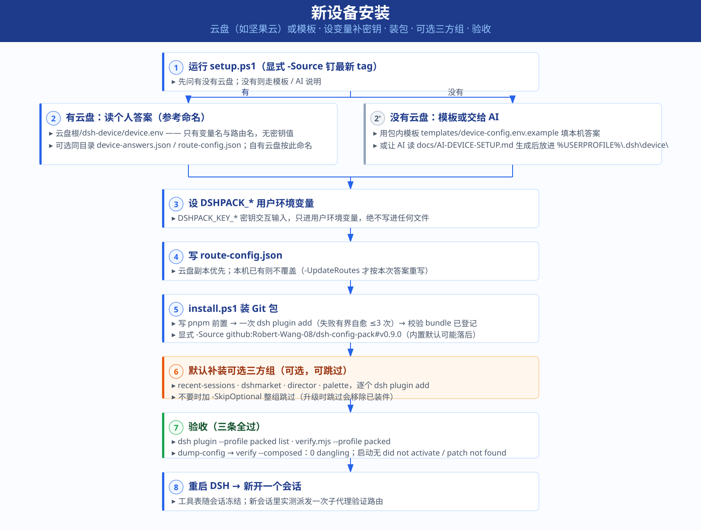
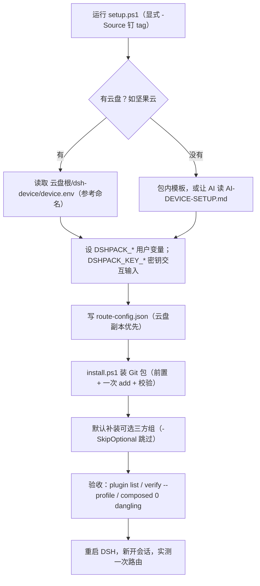

# dsh-ynm3000

> **下载使用**：适合**多 provider、多 LLM、遇阻自动切换**的重度用户——在任何新/旧机器上一条命令配好四档故障转移路由（QUOTA/AUTH/限流即切）、PTC 多代理编排与会话增强插件集，只需 `pwsh scripts/install.ps1 -ProfileName <你的profile>`（或把本仓库 README 交给 AI 代办），源与文档见 [github.com/Robert-Wang-08/dsh-config-pack](https://github.com/Robert-Wang-08/dsh-config-pack)（tag `v0.9.1`，含 `verify-install` 偏差验收与共享盘/模板两种答案方式）。**新设备装机：请让 AI 读取本 README 与 [docs/bootstrap/PROMPT-新设备装机-引导.md](docs/bootstrap/PROMPT-新设备装机-引导.md)，按引导自动完成装依赖、装 DSH、克隆仓库群、一键恢复与偏差验收。**

> **本版本（config-pack v0.9.1 · DSH 0.2.0-rc.2）能力一览**：一条命令为任意 profile 装好并钉死 16 项核心插件（官方 base/web-app/MCP 客户端 + ACP 三子代理 + keypool 四档 provider 故障转移路由 + 会话归档/侧栏管理/provider 徽标/子代理监控等增强）与 4 项可选三方件（recent-sessions/dshmarket/director/palette，`-SkipOptional` 可跳过），同时组合出 PTC 多代理编排预设、MCP 服务器开关、agent 预设与密钥指针配置层，全部组件锁钉不可变 tag、装完自动执行插件/配置偏差比较验收。

DSH 插件与配置的总仓库。各插件仍是独立仓库，这里只用 submodule 记下路径、远程地址和当前提交。

克隆：

```powershell
git clone --recurse-submodules https://github.com/Robert-Wang-08/dsh-ynm3000.git D:\src\dsh
# ↑ D:\src\dsh 只是源设备的安装实例（示例路径），按本机实际选择，后续命令同步替换。
```

已关联：

- `dsh-archived-sessions`
- `dsh-config-pack`
- `dsh-permission-compat`
- `dsh-plugin-provider-badge`
- `dsh-plugin-sidebar-visibility`
- `dsh-provider-failover`

下面三份还没有独立远程仓库，源码直接放在本仓库里：

- `dsh-plugin-ptc-switches`
- `dsh-plugin-subagent-monitor`
- `dsh-subagent-acp-resilient`

根目录的 `dsh-menu.ps1` 是本机运维入口。公开发布的一键安装仍走 `dsh-config-pack` 的 GitHub tag，不从本仓库安装。

## 新设备安装

在 `dsh-config-pack` 里一条命令。有共享盘就读已经填好的答案；没有就用包内模板，或把说明交给 AI。然后装包、写路由、设置用户环境变量。密钥不进答案文件。

**让 AI 自动配置（推荐入口）**：把 [`docs/bootstrap/PROMPT-新设备装机-引导.md`](docs/bootstrap/PROMPT-新设备装机-引导.md) 整段交给新设备的 AI 代理执行——它覆盖装依赖、装 DSH（钉 `0.2.0-rc.2`）、克隆本仓库群、从共享盘一键还原、验收与报告。三方插件（recent-sessions / dshmarket / director / palette）默认安装，prompt 里有 `-SkipOptional` 跳过开关。

没有共享盘、交给 AI 时，让 AI 读 `dsh-config-pack/docs/AI-DEVICE-SETUP.md`。生成的文件放到 `%USERPROFILE%\.dsh\device\`，再重新运行下面的命令。

共享盘答案的**参考位置**：云盘同步根（本机安装实例名为 `Skill+Tool\skillhub`）下的 `dsh-device`（`device.env` 和 `route-config.json`），不提交到 Git。「SkillHub」只是本方案的参考名称——你的云盘叫什么都行，`setup.ps1` 只认 `dsh-device\device.env` 这个约定（可选 `device-answers.json` / `route-config.json`）。日常 profile 是 `web`。`web-restore` 只在本机做验证，不作为提交内容。



英文图：[setup-flow_v2_en.svg](attachments/setup-flow_v2_en.svg)

```powershell
pwsh -File dsh-config-pack\scripts\setup.ps1 -Source 'github:Robert-Wang-08/dsh-config-pack#v0.9.1'
```



## 能力清单（逐组件：用途与 fix 原因）

### 自写插件

| 组件 | 钉的版本 | 能力（做什么用） | fix / 为什么自写 |
|---|---|---|---|
| `dsh-deepseek-keypool` | 3.4.0 | **provider 故障转移路由**：四档 tier（codex-relay → openai-codex → ais/opencode-go → kimi），QUOTA/AUTH/限流/传输错误自动切下一档，每回合最多 6 次；挂 notice 通知 | 近期 fix：隔离 base route 观察避免误判 failover 目标（e3beef1）、补通知客户端渲染回归并记录「通知不可回看」已知缺口 |
| `@local/dsh-subagent-acp-resilient` | 0.2.1 | 上游 ACP 子代理的**替换实现** | 自写原因：上游在慢响应时误判空闲超时、超时诊断被丢弃、已改文件对模型不可见——本实现给分级超时阶梯（进程 30s/建立 60s/空闲 3min/普软硬 10-20min/复杂 20-45min，`PTC_ACP_*` 可覆盖）+ `guardWorkspaceReuse` + 修 HTTP/1.1 |
| `dsh-plugin-sidebar-visibility` | 0.0.3 | Web 侧栏九项增强：工作区隐藏/折叠/拖拽排序、工作区行新建会话、会话重命名/分叉/归档、收藏+仅收藏筛选、运行中转圈标识、插件列表↔原始列表热切换、Provider 挂起/恢复 | 状态持久化在 localStorage 单键，与官方侧栏同一惯例；官方无这些 API，天然做成本地视图 |
| `dsh-plugin-provider-badge` | 0.2.1 | 模型选择器前的 provider 徽标（颜色 swatch 与文字分离，不依赖颜色辨识） | — |
| `dsh-plugin-subagent-monitor` | 0.1.0 | 会话头部「子代理 N」面板：类型徽标**优先显示实际路由**（provider/model，如「Codex-Relay (codex-relay / gpt-5.6-sol)」）+ keepalive 活性 + 后台任务实时输出环 + 一键打开子会话 | 自写原因：官方 UI 只显示任务描述看不出是哪个子代理、后台 job 输出环为空、活性无展示；本插件为只读可见性增强，不写任何数据 |
| `dsh-plugin-ptc-switches` | 0.2.0 | PTC 开关的热切换 UI（不改配置文件即可开关各模式） | — |
| `dsh-permission-compat` | 0.1.0 | **宿主补丁工具**：直接改写已装 dsh 模块（sandbox/pwsh/bash/fs）修宿主权限行为 | 不能作为 `dsh plugin` 依赖安装（带外 apply/verify/revert，带 .bak 备份），锁里标 `installable: false` |

### 上游 fork（本地改动领先上游）

| 组件 | 钉的版本 | 能力与 fix 原因 |
|---|---|---|
| `dsh-archived-sessions` | 0.4.1 | 会话归档列表/查看器/删除。本地 0.4.1 **领先** npm 公开版 0.4.0，所以走本仓库 tag 而不是 npm——改回去会静默丢本地改动 |

归档界面（上游自带截图）：


### 第三方插件（按上游维护，本包只消费版本号）

| 组件 | 钉的版本 | 能力 |
|---|---|---|
| `dsh-chat-import` | 0.25.2 | 外部聊天记录导入（interchange v1） |
| `dsh-mermaid-smooth` | 0.1.0 | mermaid 图渲染体验优化 |
| `dsh-notify-bell` | 0.12.0 | 桌面通知铃（上游无 repository 字段，按 npm 包名+版本定位） |

### 可选三方组（默认装，`-SkipOptional` 整组跳过；清单见 `assets/optional-components.json`）

| 组件 | 钉的版本 | 能力 |
|---|---|---|
| `dsh-recent-sessions` | v0.1.2 | 最近会话列表（huangxp12/dsh-recent-sessions） |
| `dshmarket` | v1.66.21 | 插件市场面板 |
| `dsh-plugin-subagent-director` | 0.5.6 | 子代理调度增强 |
| `dsh-palette` | 0.2.1 | 调色面板 |

### 配置层能力（本包 patch + 组合锁提供）

- **四档 provider 故障转移路由** + `subagentRouting` 分工链（设计/开发/验证/长连续各有候选顺序）
- **ACP 路由开关与超时阶梯**（`DSHPACK_ACP_OPENCODE/KIMI/CURSOR`）
- **4 个 MCP 服务器开关**：codegraph（默认关，需自备）、ticktick（设入口即开）、腾讯文档/幻灯片（需 token）
- **agent 预设注册表** + 默认 provider/model（`DSHPACK_DEFAULT_*`、`DSHPACK_SELECTED_PRESET`）
- **密钥指针**：`DSHPACK_KEY_*` 只写引用名，真实值在用户环境变量，装完打印缺失清单
- 每个组件**钉不可变 annotated tag + 解引用 commit**（`verify-components` 联网强制），装完跑 `verify-install.mjs` 偏差比较验收
