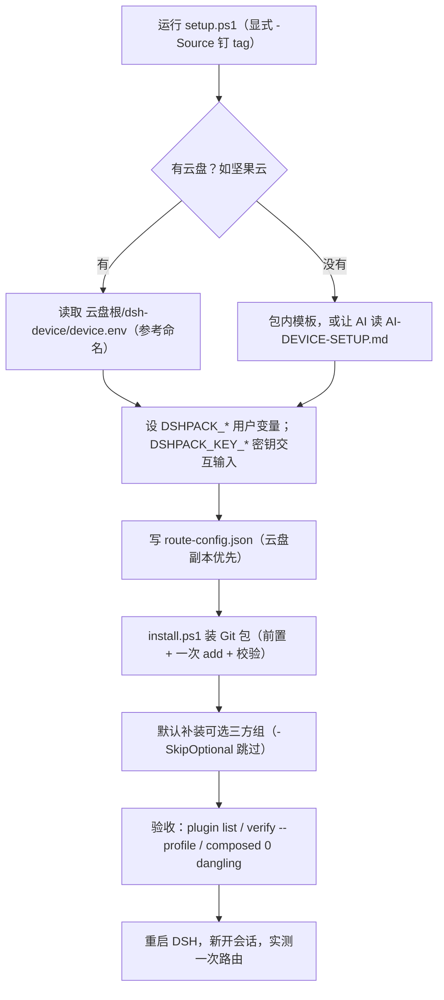

# dsh-ynm3000

> **下载使用**：适合**多 provider、多 LLM、遇阻自动切换**的重度用户——在任何新/旧机器上一条命令配好四档故障转移路由（QUOTA/AUTH/限流即切）、PTC 多代理编排与会话增强插件集，只需 `pwsh scripts/install.ps1 -ProfileName <你的profile>`（或把本仓库 README 交给 AI 代办），源与文档见 [github.com/Robert-Wang-08/dsh-config-pack](https://github.com/Robert-Wang-08/dsh-config-pack)（tag `v0.9.1`，含 `verify-install` 偏差验收与共享盘/模板两种答案方式）。**新设备装机：请让 AI 读取本 README 与 [docs/bootstrap/PROMPT-新设备装机-引导.md](docs/bootstrap/PROMPT-新设备装机-引导.md)，按引导自动完成装依赖、装 DSH、克隆仓库群、一键恢复与偏差验收。**

> **本版本（config-pack v0.9.1 · DSH 0.2.0-rc.2）能力一览**：一条命令为任意 profile 装好并钉死 16 项核心插件（官方 base/web-app/MCP 客户端 + ACP 三子代理 + keypool 四档 provider 故障转移路由 + 会话归档/侧栏管理/provider 徽标/子代理监控等增强）与 4 项可选三方件（recent-sessions/dshmarket/director/palette，`-SkipOptional` 可跳过），同时组合出 PTC 多代理编排预设、MCP 服务器开关、agent 预设与密钥指针配置层，全部组件锁钉不可变 tag、装完自动执行插件/配置偏差比较验收。

DSH 插件与配置的总仓库。各插件仍是独立仓库，这里只用 submodule 记下路径、远程地址和当前提交。

克隆：

```powershell
git clone --recurse-submodules https://github.com/Robert-Wang-08/dsh-ynm3000.git D:\src\dsh
# ↑ D:\src\dsh 只是源设备的安装实例（示例路径），按本机实际选择，后续命令同步替换。
```

已关联：

- `dsh-archived-sessions`
- `dsh-config-pack`
- `dsh-permission-compat`
- `dsh-plugin-provider-badge`
- `dsh-plugin-sidebar-visibility`
- `dsh-provider-failover`

下面三份还没有独立远程仓库，源码直接放在本仓库里：

- `dsh-plugin-ptc-switches`
- `dsh-plugin-subagent-monitor`
- `dsh-subagent-acp-resilient`

根目录的 `dsh-menu.ps1` 是本机运维入口。公开发布的一键安装仍走 `dsh-config-pack` 的 GitHub tag，不从本仓库安装。

## 新设备安装

在 `dsh-config-pack` 里一条命令。有共享盘就读已经填好的答案；没有就用包内模板，或把说明交给 AI。然后装包、写路由、设置用户环境变量。密钥不进答案文件。

**让 AI 自动配置（推荐入口）**：把 [`docs/bootstrap/PROMPT-新设备装机-引导.md`](docs/bootstrap/PROMPT-新设备装机-引导.md) 整段交给新设备的 AI 代理执行——它覆盖装依赖、装 DSH（钉 `0.2.0-rc.2`）、克隆本仓库群、从共享盘一键还原、验收与报告。三方插件（recent-sessions / dshmarket / director / palette）默认安装，prompt 里有 `-SkipOptional` 跳过开关。

没有共享盘、交给 AI 时，让 AI 读 `dsh-config-pack/docs/AI-DEVICE-SETUP.md`。生成的文件放到 `%USERPROFILE%\.dsh\device\`，再重新运行下面的命令。

共享盘答案的**参考位置**：云盘同步根（本机安装实例名为 `Skill+Tool\skillhub`）下的 `dsh-device`（`device.env` 和 `route-config.json`），不提交到 Git。「SkillHub」只是本方案的参考名称——你的云盘叫什么都行，`setup.ps1` 只认 `dsh-device\device.env` 这个约定（可选 `device-answers.json` / `route-config.json`）。日常 profile 是 `web`。`web-restore` 只在本机做验证，不作为提交内容。


英文图：[setup-flow_v2_en.svg](attachments/setup-flow_v2_en.svg)

```powershell
pwsh -File dsh-config-pack\scripts\setup.ps1 -Source 'github:Robert-Wang-08/dsh-config-pack#v0.9.1'
```


