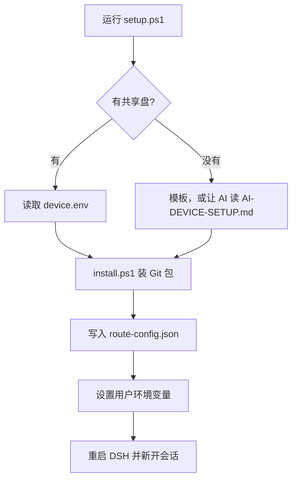

# dsh-ynm3000

DSH 插件与配置的总仓库。各插件仍是独立仓库，这里只用 submodule 记下路径、远程地址和当前提交。

克隆：

```powershell
git clone --recurse-submodules https://github.com/Robert-Wang-08/dsh-ynm3000.git D:\src\dsh
```

已关联：

- `dsh-archived-sessions`
- `dsh-config-pack`
- `dsh-permission-compat`
- `dsh-plugin-provider-badge`
- `dsh-plugin-sidebar-visibility`
- `dsh-provider-failover`

下面三份还没有独立远程仓库，源码直接放在本仓库里：

- `dsh-plugin-ptc-switches`
- `dsh-plugin-subagent-monitor`
- `dsh-subagent-acp-resilient`

根目录的 `dsh-menu.ps1` 是本机运维入口。公开发布的一键安装仍走 `dsh-config-pack` 的 GitHub tag，不从本仓库安装。

## 新设备安装

在 `dsh-config-pack` 里一条命令。有共享盘就读已经填好的答案；没有就用包内模板，或把说明交给 AI。然后装包、写路由、设置用户环境变量。密钥不进答案文件。

没有共享盘、交给 AI 时，让 AI 读 `dsh-config-pack/docs/AI-DEVICE-SETUP.md`。生成的文件放到 `%USERPROFILE%\.dsh\device\`，再重新运行下面的命令。

本机共享盘是 SkillHub。已经填好的答案在它下面的 `dsh-device`（`device.env` 和 `route-config.json`），不提交到 Git。日常 profile 是 `web`。`web-restore` 只在本机做验证，不作为提交内容。


英文图：[setup-flow_v1_en.svg](attachments/setup-flow_v1_en.svg)

```powershell
pwsh -File dsh-config-pack\scripts\setup.ps1
```


