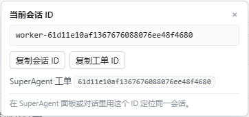

# dsh-plugin-session-id

DSH Web 会话头部增强：在标题旁加一个**「会话 ID」**按钮，一眼看到当前 Session ID，一键复制；当会话是 SuperAgent 执行器会话（`worker-<ticketId>`）时，同时给出对应工单 ID 并可单独复制。

只读会话标识：不读会话内容、不写 settings、不发请求、不持凭据。

## 1. 需求与结论

需求：**从会话上拿到 session ID**，便于和 SuperAgent 交互式查看。

分析结论：

1. **会话身份的唯一权威来源是 `SessionId`**。DSH 的会话作用域 slot 会把标准 props 随作用域投递给组件，其中包含 `sessionId`（先例：`dsh-plugin-subagent-monitor` 在 `conversation.session.header.actions` 里用 `props.sessionId`）。因此客户端插件**不需要 RPC、不需要读磁盘、不需要鉴权**就能拿到当前会话 ID。
2. **现有界面不显示它**。会话头部的面包屑只渲染 `displayTitle`（只有会话尚未进入会话列表时才回退显示裸 ID），Web 端也没有把 session 放进 URL 的深链。用户在 GUI 里没有可靠的办法读出、复制当前会话 ID。
3. **正确的扩展点是公开的 slot**：`conversation.session.header.actions` 是 list 类型、`scope: 'session'` 的官方席位，注册后自动获得当前 `sessionId`，不需要改 DSH 本体。
4. **和 SuperAgent 的对应关系是确定的**：dsh-superagent 的每个工单执行器会话固定命名 `worker-<ticketId>`（源码 `executor/dsh.ts` 的 `workerSessionId`），面板的「打开 Session」也是按 session id 导航（`openKnownSession` + `uiWorkspace.openSession`）。所以：复制会话 ID 或复制工单 ID，就能在 GUI 会话与 SuperAgent 的工单之间对齐同一条工作。

其它获取途径与取舍：

| 途径 | 可用性 | 取舍 |
| --- | --- | --- |
| session 作用域 slot props（本插件） | 官方公开扩展点 | 只在会话页生效，正是需求场景 |
| `~/.dsh/sessions/<编码后的 cwd>/<sessionId>/` | 磁盘上可读 | 需要知道工作区编码，不是 UI 操作 |
| `dsh tui --resume <session>` | 仅 tui profile | Web 界面里拿不到 ID，无法反向使用 |
| 浏览器 devtools / 读取 React 树 | 技术上可行 | 不稳定、不可教给普通用户 |

## 2. 界面行为

- 会话头部标题旁出现 **「会话 ID」** 按钮（`order: 15`，排在子代理面板之前）。
- 点击打开弹层：
  - `当前会话 ID`：完整 ID，等宽字体、可直接选中；
  - **复制会话 ID**：写入剪贴板，成功后显示「已复制」1.8 秒；
  - 执行器会话额外显示 **SuperAgent 工单 `<ticketId>`** 和 **复制工单 ID**；
  - 底部提示：在 SuperAgent 面板或对话里用这个 ID 定位同一会话。
- 点弹层外或按 `Esc` 关闭；`Tab` 可聚焦，`aria-expanded` / `aria-controls` / `role="dialog"` / `role="status"` 齐备。
- 剪贴板：优先 `navigator.clipboard.writeText`；不可用或被拒绝时退回隐藏 `textarea` + `execCommand('copy')`；仍失败则明确提示「复制失败，请手动选择文本」，不假装成功。

## 3. 安装

插件以 `link:` 依赖登记后，`git pull` + 重启即得后续更新（工作区 AGENTS.md §8）：

```powershell
git -C D:\src\dsh pull
dsh plugin --profile web add D:\src\dsh\dsh-plugin-session-id
# 重启 dsh web，并新开一个会话（客户端 bundle 在页面加载时拼入）
```

只想先在测试 profile 验证：

```powershell
dsh plugin --profile plugintest add D:\src\dsh\dsh-plugin-session-id
dsh --profile plugintest --host 127.0.0.1 --port 3081 --no-open
```

回滚：`dsh plugin --profile <profile> remove dsh-plugin-session-id`，重启即可。

## 4. 验收

```powershell
node dsh-plugin-session-id/test/smoke-client.mjs
dsh --profile <profile> --dump-config > $null   # 无 did not activate / patch entry not found
```

界面验收（截图见 `docs/screenshots/`）：打开任一会话，标题旁出现「会话 ID」；点开可见完整 ID；点「复制会话 ID」后反馈「已复制」；执行器会话出现工单行。

实拍证据（DSH 0.2.1-rc.5，`plugintest` profile，1440×900，浅色主题，同一会话；为避开会话标题与对话内容，只截头部动作区和弹层本身）：

- Before（插件未安装，头部动作区只有预设标签）：
- After（预设标签右侧出现「会话 ID」）：
- After（弹层显示完整会话 ID、SuperAgent 工单 ID 与复制入口）：

## 5. 限制

- 只覆盖 Web 客户端；TUI/headless 不加载 client bundle。
- 只展示当前会话的 ID，不修改会话标题，也不写任何会话数据。
- 复制依赖浏览器剪贴板权限；受限环境会回退到 `execCommand`，再失败则提示手动选择。
- 没有 URL 深链：ID 需要手工粘贴给 SuperAgent（面板或对话）。这是宿主当前的路由机制，不在本插件范围内改。
- 兼容性以运行时验证为准：本插件不声明 `peerDependencies` / `engines`，已在 DSH 0.2.1-rc.5 的 `plugintest` profile 激活并实拍。
